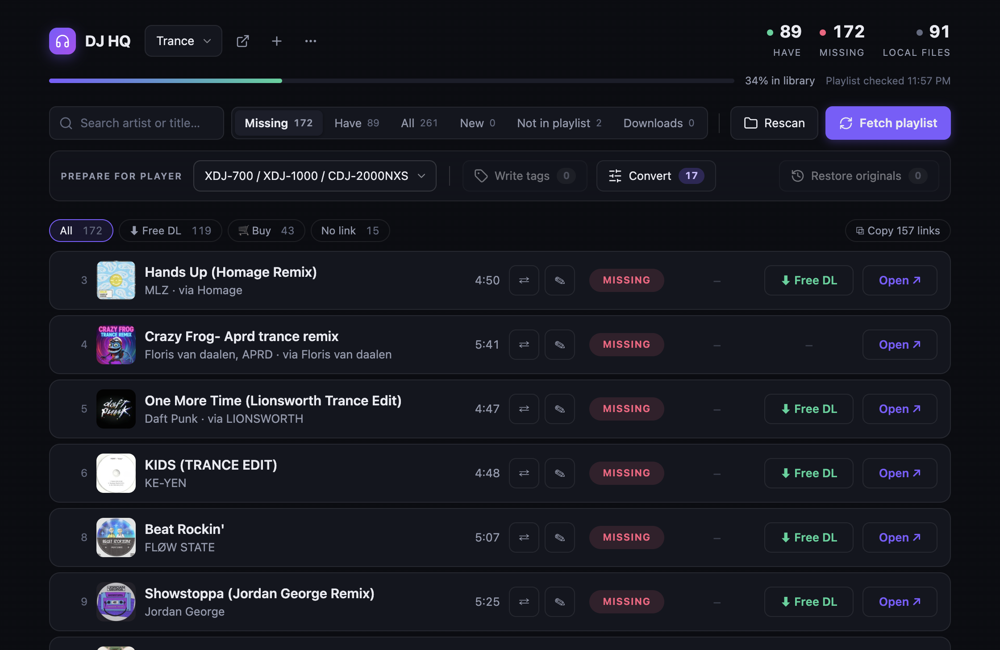

# DJ HQ 🎧

A desktop app for DJs who collect tracks from SoundCloud playlists and play
them through rekordbox on Pioneer gear. It answers three questions that normally
cost you an evening:

1. **Which tracks from my playlist do I actually have on disk?**
2. **Why does rekordbox show blank artist/title for my WAVs?**
3. **Why won't my XDJ/CDJ play this file?**



## What it does

- **Reconcile** — fetches the live state of a public SoundCloud playlist and
  fuzzy-matches it against a local folder (filename + duration), giving you a
  Have / Missing view with direct links to every missing track. The playlist
  is re-checked on launch and every 15 minutes while the window is visible,
  and you're told when tracks were added or removed. Added tracks are flagged
  **NEW** and collected in a *New* tab until you press *Mark all as seen*.
  Where the
  uploader set a purchase link, the row shows a **Free DL** or **Buy** button
  going straight to the gate or shop (Hypeddit, Bandcamp, Beatport, …). The
  track description is scanned too, so a "FREE DL: https://…" line or a
  Google Drive share in the text gets a button as well (socials and streaming
  links are ignored). When a track has both, **Buy** comes first — shops sell
  lossless files, free downloads are often MP3 — and Bandcamp is preferred
  over other shops. Hover a button to see the link's own wording, host, and
  the format when the text or the shop makes it certain.
- **Tag** — writes rekordbox-compatible metadata to matched files: ID3v2.3 with
  UTF-16 frames *plus* a RIFF `INFO` chunk for WAVs (rekordbox is picky — plain
  UTF-8 ID3v2.3 tags are silently ignored). Genre is taken from the playlist name.
  Artist/title come from the playlist but every track is editable inline.
- **Convert** — checks each file against your player's real limits (e.g. the
  XDJ-700 only plays 16-bit WAV at 44.1/48 kHz) and converts incompatible files
  **in place**: same filename, same duration. Because rekordbox references tracks
  by path and stores cues by time, your hot cues, memory cues and beat grids
  survive without re-importing.
- **Missing, filtered** — the Missing tab can be narrowed to tracks with a
  free download, a shop link, or no link at all, and *Copy links* puts
  "Artist – Title ⇥ link" for every track shown on the clipboard. A track you
  can't get right now can be marked **N/A** (click the MISSING pill twice): it
  leaves the Missing list and comes back by itself when a download or shop
  link appears for it. The Have tab flags MP3s whose shop link sells a
  lossless file (*⬆ lossless available*).
- **Downloads** — fresh files in your Downloads folder are matched against the
  playlist the same way the library is. A download for a missing track gets a
  *Move into library* button; a lossless download for a track you only have as
  MP3 gets *Upgrade* (the MP3 is kept in the backup folder). Files move as
  they are, no renaming, and are pinned to their track. Set `inbox_dir` in
  state.json to watch a different folder.
- **Not in playlist** — local files that match nothing in the playlist get
  their own tab. *Find on SoundCloud* searches for the track (by name and
  duration), you add it to the playlist on SoundCloud with one click, and once
  it shows up there the file is matched to it automatically. *Find all* fills
  in the sure matches for you and leaves doubtful ones for a manual pick.
- **Export to rekordbox** — ⋯ menu → *Export rekordbox XML…* writes the matched
  files of every library as rekordbox playlists, in SoundCloud order, to one
  file in the app's data folder. Point rekordbox at it once (Preferences →
  Advanced → Database → rekordbox xml) and import the playlist from the
  *rekordbox xml* node in the tree; tracks already in your collection keep
  their cues. Export again whenever the playlist changes — same path.
- **Multiple libraries** — each links one folder to one playlist; switch in the
  header.

## Install

### Download (recommended)

Grab the latest build from the
[Releases page](https://github.com/Banneh/playlist-app/releases):

| Platform | File |
| --- | --- |
| macOS (Apple Silicon) | `DJ HQ-<version>-arm64.dmg` |
| Windows | `DJ HQ Setup <version>.exe` |
| Linux | `DJ HQ-<version>.AppImage` |

ffmpeg is bundled — there is nothing else to install.

The builds are **unsigned** (no paid developer certificates), so the OS will
warn on first launch:

- **macOS**: right-click the app → *Open* → *Open*. If macOS says the app is
  "damaged", clear the quarantine flag instead:
  `xattr -cr "/Applications/DJ HQ.app"`
- **Windows**: SmartScreen → *More info* → *Run anyway*.

On an Intel Mac, run from source instead (below).

### Run from source

Requires [Node.js](https://nodejs.org) 20+.

```
git clone https://github.com/Banneh/playlist-app.git
cd playlist-app
npm install
npm start
```

### Headless mode

The same UI served to your browser, no Electron window:

```
npm run headless        # then open http://localhost:8765
```

Port and data location can be overridden with `DJHQ_PORT` and `DJHQ_DATA_DIR`.

### Where your data lives

The packaged app keeps its state (libraries, playlist snapshots, manual edits)
in the OS user-data folder — `~/Library/Application Support/DJ HQ` on macOS.
Running from source keeps `state.json` in the project folder. Conversion
backups are stored next to the state in `originals/<library>/`.

## Safety

This app rewrites files inside your music library, so it is paranoid about it:

- Tag writes copy the audio bit-perfectly and **verify the audio MD5** before
  replacing the file; on any mismatch the original stays untouched.
- Conversions **back up the untouched original** to `originals/<library>/` first,
  verify duration after converting, and there's a one-click *Restore originals*
  button. Backups are never deleted by the app.
- Files whose fix would require changing the extension (e.g. FLAC → WAV) are
  skipped with a warning instead of silently breaking your rekordbox references.

Still: it's your library — keep your own backups too.

## A note on SoundCloud

There is no API key to configure: the app reads the same public endpoints the
SoundCloud web player uses, with a client id scraped from their public JS. This
is the yt-dlp school of integration — it works today, it may break whenever
SoundCloud changes their frontend, and it is not an official API. Only public
playlists work. The app fetches the playlist on launch, every 15 minutes while
the window is visible, and when you click *Fetch playlist* — nothing else.

## Troubleshooting

- **Rekordbox still shows old bitrate/bit-depth after converting** — that column
  is cached in rekordbox's database. *Reload Tag* only refreshes text tags; use
  right-click → *Analyze Track* (hot cues survive; beat grids are recalculated),
  or just ignore it — playback and USB export always use the actual file.
- **Tags don't show for tracks already in rekordbox** — rekordbox doesn't
  re-read files on its own: select the tracks → right-click → *Reload Tag*.
- **A match is wrong** — click the HAVE/MISSING pill to override it (on a
  missing track a second click marks it N/A, a third goes back to automatic),
  and ✎ to fix artist/title before tagging.
- **No Free DL / Buy buttons** — the uploader set no purchase link and wrote
  none in the description, so only *Open* is shown. (After updating from an older version the
  buttons appear once the launch refresh has run.)
- **"Couldn't load the library: operation not permitted" (macOS)** — give the
  app access to your music folder in System Settings → Privacy & Security →
  Files and Folders.

## Development

```
npm run build       # compile TypeScript to dist/
npm start           # build + open the Electron app
npm run dist        # build installers locally into release/
```

Releases are built by GitHub Actions: pushing a `v*` tag builds macOS, Windows
and Linux installers and publishes them to the Releases page.

## Out of scope (for now)

Spotify/Apple Music playlists, private playlists (needs OAuth), automatic
downloading of missing tracks, and rekordbox database editing. Issues and PRs
welcome.

## License

MIT — see [LICENSE](LICENSE).
