# DJ HQ

**Keep your music folder in sync with a SoundCloud playlist, and get your tracks ready for rekordbox and the club.**

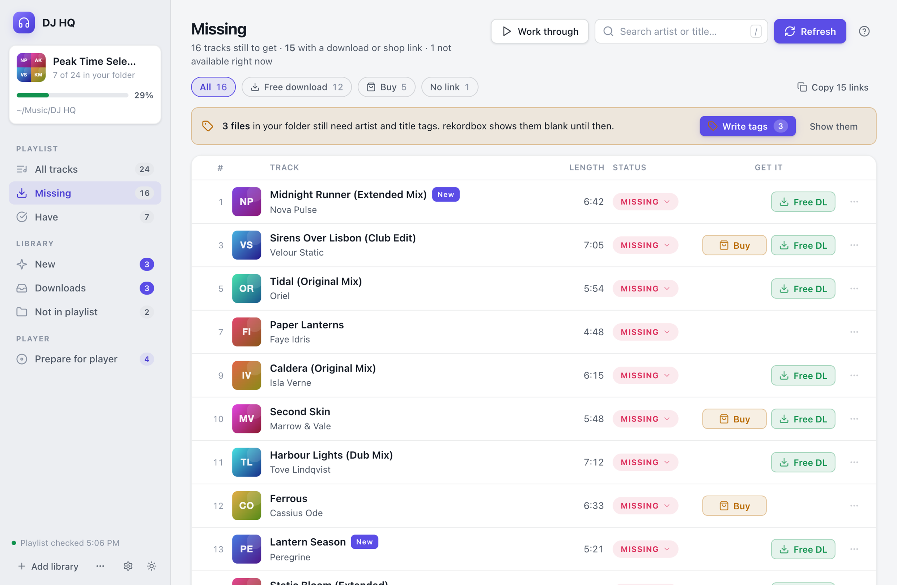

DJ HQ is a free desktop app for DJs who collect music through SoundCloud
playlists. It compares a playlist with the folder where your tracks live, shows
you what's still missing and where to get it, tidies up the files you have so
rekordbox and Pioneer players are happy, and hands you a rekordbox playlist when
you're done. Everything runs on your computer; nothing is uploaded anywhere.

## Contents

- [What DJ HQ does](#what-dj-hq-does)
- [Install](#install)
  - [Download](#download)
  - [Opening the app for the first time](#opening-the-app-for-the-first-time)
  - [Updating](#updating)
- [Getting started](#getting-started)
- [Using DJ HQ](#using-dj-hq)
  - [Missing: tracks you still need](#missing-tracks-you-still-need)
  - [Have: tracks already in your folder](#have-tracks-already-in-your-folder)
  - [New: what changed since you last looked](#new-what-changed-since-you-last-looked)
  - [Downloads: moving new files into your library](#downloads-moving-new-files-into-your-library)
  - [Not in playlist: files SoundCloud doesn't know about](#not-in-playlist-files-soundcloud-doesnt-know-about)
  - [Prepare for player: tags, conversion and rekordbox](#prepare-for-player-tags-conversion-and-rekordbox)
  - [Appearance, search and the sidebar](#appearance-search-and-the-sidebar)
  - [Settings](#settings)
  - [More than one folder](#more-than-one-folder)
  - [More than one playlist](#more-than-one-playlist)
- [Tips and troubleshooting](#tips-and-troubleshooting)
- [Your files and your data](#your-files-and-your-data)
- [Technical details](#technical-details)
  - [Run from source](#run-from-source)
  - [Headless mode](#headless-mode)
  - [Project layout](#project-layout)
  - [HTTP API](#http-api)
  - [Releases](#releases)
  - [Out of scope](#out-of-scope)
- [License](#license)

## What DJ HQ does

A *library* in DJ HQ is a music folder (or several) linked to one public
SoundCloud playlist. The app fetches the playlist, scans the folders and works
out which file belongs to which track by comparing names and lengths.
Everything else builds on that:

- **Missing** lists every playlist track that isn't in your folder yet, with a
  **Free DL** or **Buy** button that takes you straight to the download gate or
  the shop. Links are found in the track's download button *and* in its
  description.
- **Have** shows the file behind each track you own, and flags anything that
  still needs tags, conversion, or could be upgraded from MP3 to lossless.
- **New** collects tracks added to the playlist and files that arrived in your
  folder since you last looked.
- **Downloads** watches your Downloads folder and moves new files into your
  library with one click, no renaming. Bandcamp zips are looked inside, and
  exact matches can move in on their own.
- **Not in playlist** finds the SoundCloud track for files that aren't in the
  playlist yet, so you can add them there.
- **Prepare for player** writes artist and title tags the way rekordbox reads
  them, converts files your Pioneer player can't play (in place, so your cues
  survive), and exports a rekordbox playlist.
- Every file can be **previewed** in the app, and a library can follow your
  SoundCloud **Likes** instead of a playlist.

The playlist is checked again every 15 minutes while the window is open, and
whenever you press **Refresh**. DJ HQ never writes to SoundCloud and never
needs your SoundCloud login.

## Install

### Download

Get the latest build from the
[Releases page](https://github.com/Banneh/playlist-app/releases):

| Your computer | File to download |
| --- | --- |
| Mac with Apple Silicon (M1 or later) | `DJ-HQ-<version>-mac-arm64.dmg` |
| Mac with an Intel chip | `DJ-HQ-<version>-mac-x64.dmg` |
| Windows | `DJ-HQ-Setup-<version>.exe` |
| Linux | `DJ-HQ-<version>.AppImage` |

> [!TIP]
> Not sure which Mac you have? Click the Apple menu → **About This Mac**. If it
> says *Chip: Apple M…* you want the Apple Silicon file; if it says
> *Processor: Intel…* you want the Intel one.

There's nothing else to install; ffmpeg comes bundled.

### Opening the app for the first time

DJ HQ isn't signed with an Apple or Microsoft developer certificate (they cost
money), so your computer asks you to vouch for it once. No Terminal needed.

**macOS 15 (Sequoia) or newer**

1. Open the DMG, drag **DJ HQ** into **Applications**, then double-click it.
   macOS says it couldn't verify the app. Click **Done**.
2. Open **System Settings → Privacy & Security** and scroll down to the
   *Security* section. Next to "DJ HQ was blocked", click **Open Anyway**.
3. Confirm with your password or Touch ID. From then on it opens like any
   other app.

**macOS 14 (Sonoma) or older**

Right-click (or Control-click) **DJ HQ** in Applications, choose **Open**,
then click **Open** in the dialog. Once is enough.

**Windows**

SmartScreen says it protected your PC. Click **More info**, then
**Run anyway**.

### Updating

DJ HQ looks for a newer version on GitHub once a day. When there is one, a
small notice appears at the bottom of the sidebar with a **Download** button
for your computer. Install the new version over the old one; your library and
settings stay where they are. **⋯ → Check for updates…** checks right away.

## Getting started

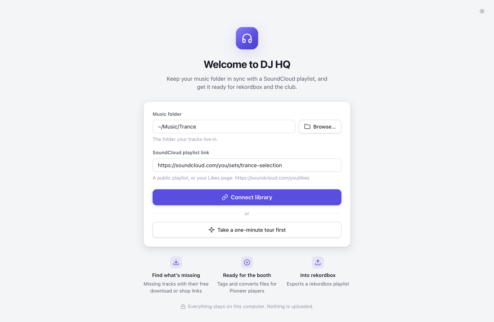

1. Click **Browse…** and pick the folder where your tracks live (or type the
   path).
2. Paste the link to your SoundCloud playlist. It has to be public, that's
   all. If you collect by liking tracks instead, paste your Likes page
   (`https://soundcloud.com/you/likes`); it works the same way.
3. Click **Connect library**.

DJ HQ fetches the playlist, scans the folder and matches files to tracks. That
takes a few seconds for a few hundred tracks. You land on the **Missing** list,
and the sidebar shows how much of the playlist is already in your folder.

The first time, DJ HQ offers a one-minute tour that points out what each list
is for. It runs on a few sample tracks, so you can take it before connecting
anything (there's a button for it on the welcome screen) and nothing in your
own library changes. Click **Not now** to skip it; **⋯ → Show me around**
replays it any time.

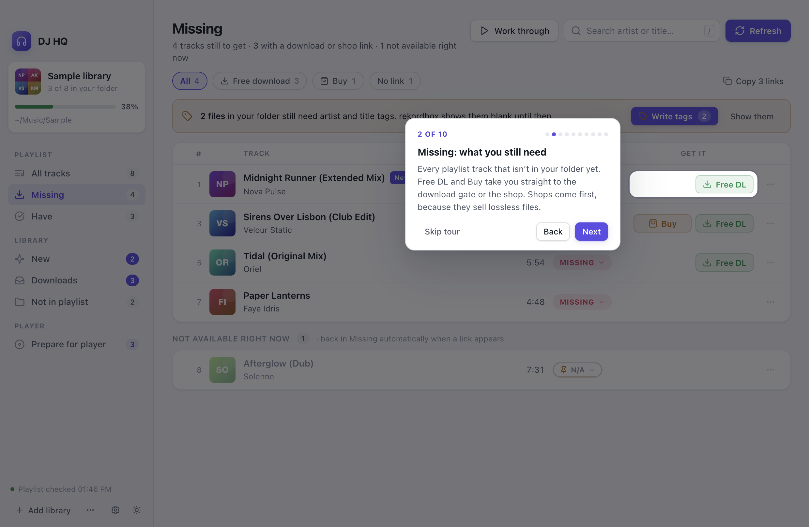

> [!NOTE]
> Nothing is renamed, moved or rewritten at this point. DJ HQ only reads your
> folder until you ask it to write tags, convert a file or move a download.

## Using DJ HQ

### Missing: tracks you still need

This is the list you'll spend the most time in: every track from the playlist
that isn't in your folder, with the quickest way to get it.

- **Free DL** is a free download: a Hypeddit-style gate, a Drive or Dropbox
  share, or SoundCloud's own download button.
- **Buy** is a shop: Bandcamp, Beatport, Juno, Traxsource and friends. When a
  track has both, Buy comes first, because shops sell lossless files and free
  downloads are often MP3s. Hover a button to see where it goes.

**To work through the list**

1. Use the chips above the list to narrow it down: tracks with a free download,
   with a shop link, or with no link at all.
2. Click **Free DL** or **Buy**. The link opens in your browser; the file ends
   up in your Downloads folder as usual.
3. Switch to **Downloads** in the sidebar once a few files have landed, and
   move them into your library from there (see below).

**Working through a long list**

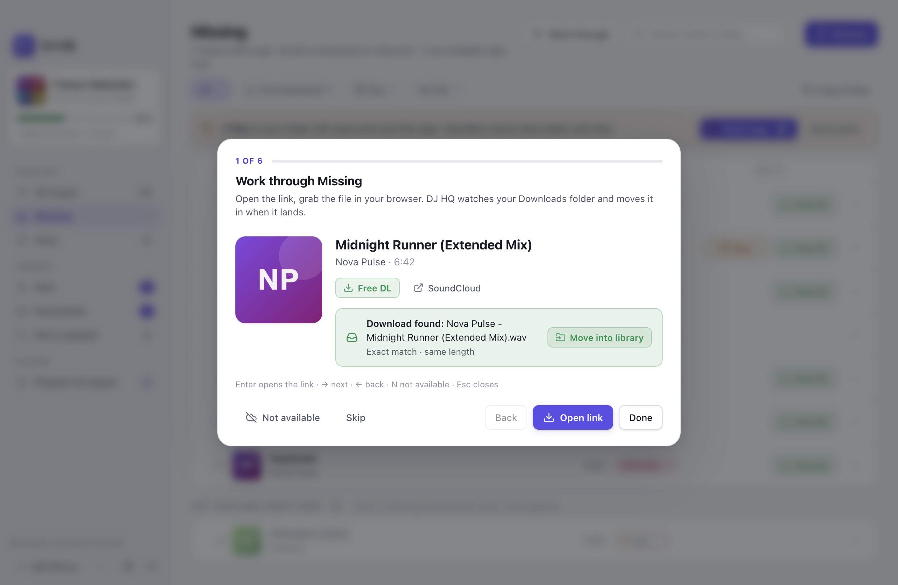

**Work through** (top right) takes the list one track at a time: artwork, the
links, and a watch on your Downloads folder. Open the link, grab the file in
your browser, and when it lands DJ HQ offers **Move into library** and steps to
the next track. Enter opens the link, the arrow keys step, N parks a track as
not available, Esc closes.

**Other things you can do here**

- **Copy links** puts every track on screen on your clipboard as
  "Artist – Title, link", one per line. Handy for a shopping session.
- Click a track's status pill to change it by hand. **Not available on
  SoundCloud now** parks a track in a quiet section at the bottom; it comes
  back on its own the moment a link appears for it. **Back to automatic**
  undoes any manual status.
- The **⋯** at the end of a row opens the track on SoundCloud, copies its
  links, matches a file by hand, or lets you fix the artist and title.
- Click the artwork to open the track on SoundCloud.

<p align="center">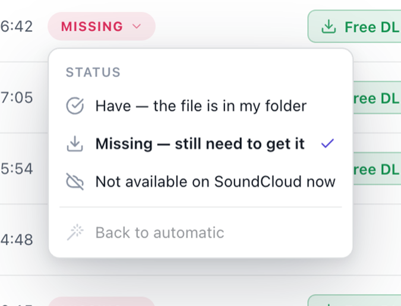</p>

### Have: tracks already in your folder

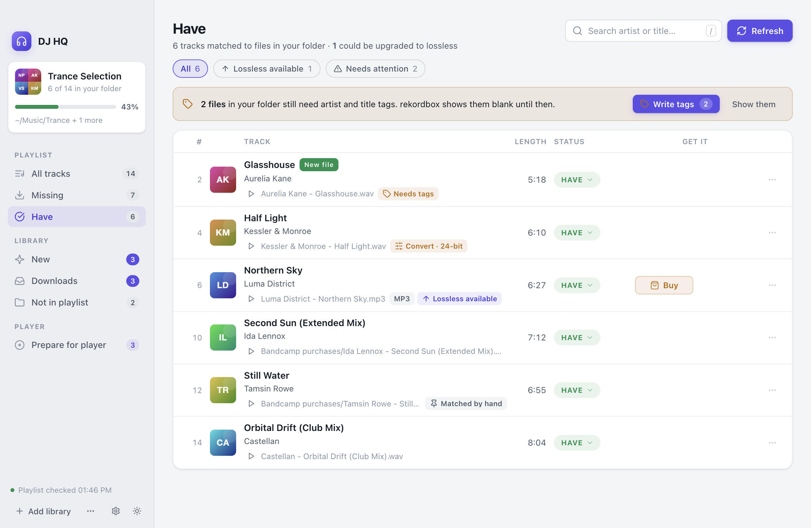

Each track shows the file it was matched to, plus a small tag when something
needs attention:

| Tag | Meaning |
| --- | --- |
| **Needs tags** | Artist and title aren't written into the file yet. rekordbox would show it blank. |
| **Convert · 24-bit** (or 88.2 kHz, …) | The selected player can't play this file as it is. |
| **MP3** | A lossy file. |
| **Lossless available** | You have the MP3, and the shop link sells a lossless version. |
| **Matched by hand** | You picked this file yourself. |

The **Needs tags**, **Needs convert** and **Lossless available** chips above
the list show only those tracks, and the counts on the Prepare for player cards
open the same chips. While any file still needs tags, a notice above the
playlist lists how many and offers **Write tags** right there, so you don't
have to go to Prepare for player for that. A file that needs the same work but
isn't in the playlist is mentioned under the list, with a link to Not in
playlist.

The small play button in front of a file name previews it right in the app; a
player bar appears at the bottom with seek and volume. The same button sits in
the match dialog, so you can check a shaky match by ear.

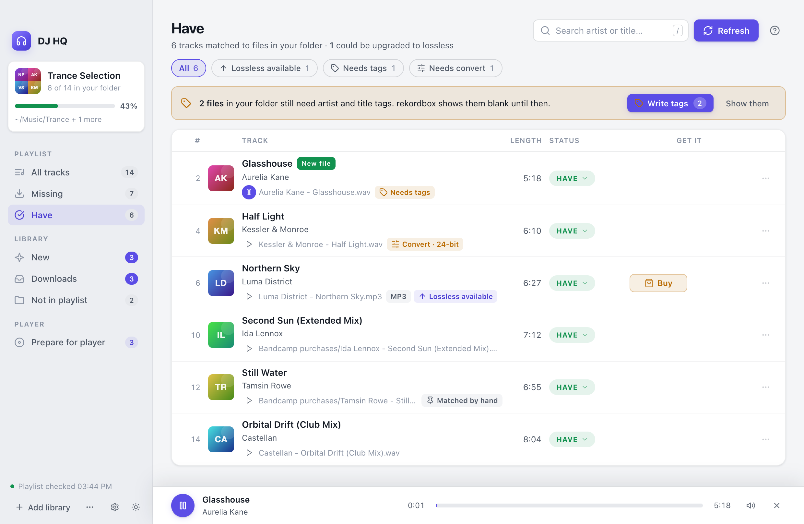

**To fix a wrong match**

1. Click the file name under the track, or choose **⋯ → Match to a local
   file…**.
2. Pick the right file. Likely candidates are listed first; files already
   matched to another track are marked, and picking one frees that track to
   match again.
3. Choose **No file** if the track isn't in your folder at all, or
   **Auto-match** to let DJ HQ decide again.

<p align="center">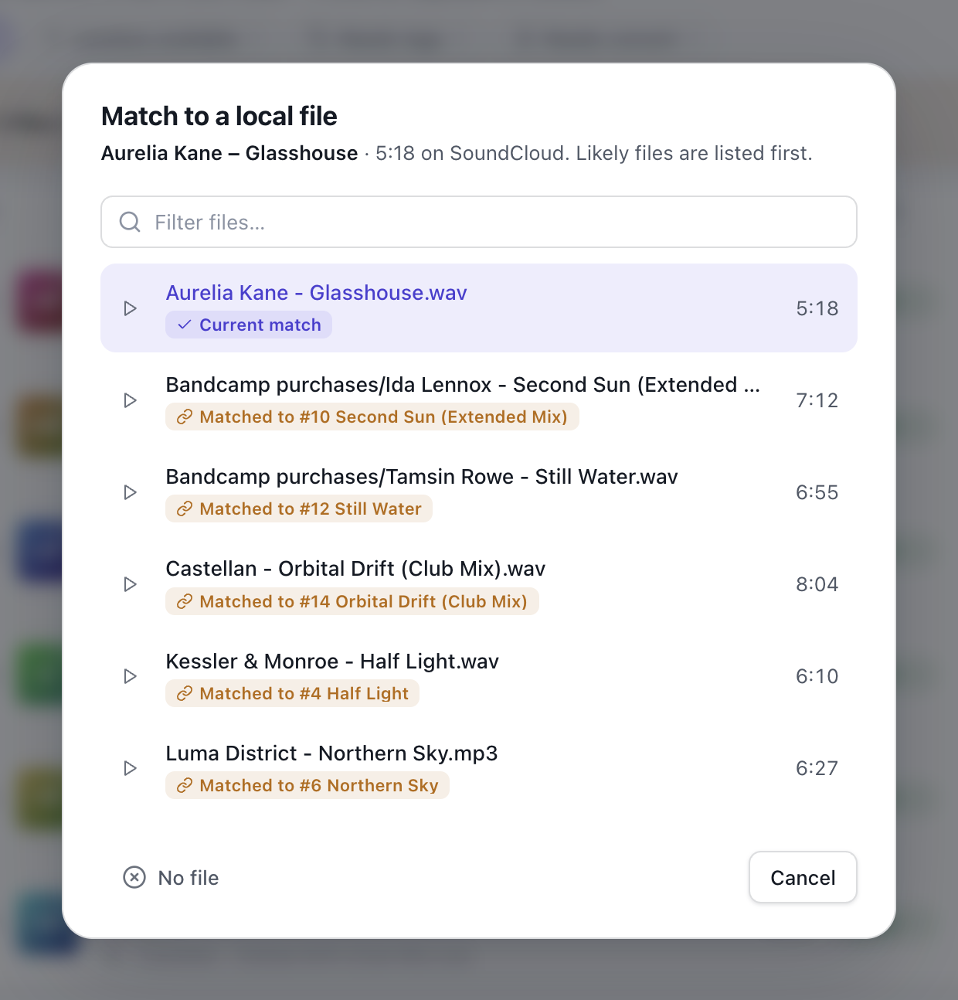</p>

### New: what changed since you last looked

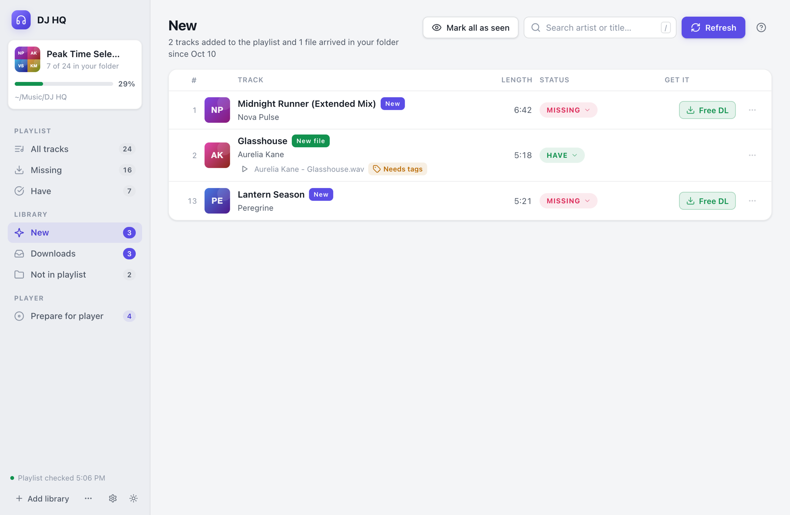

Tracks added to the playlist (**New**) and files that arrived in your folder
(**New file**) collect here until you press **Mark all as seen**. Treat it as
the to-do list for tagging, converting and importing into rekordbox. When a
refresh finds changes, a short notice tells you how many tracks were added or
removed.

### Downloads: moving new files into your library

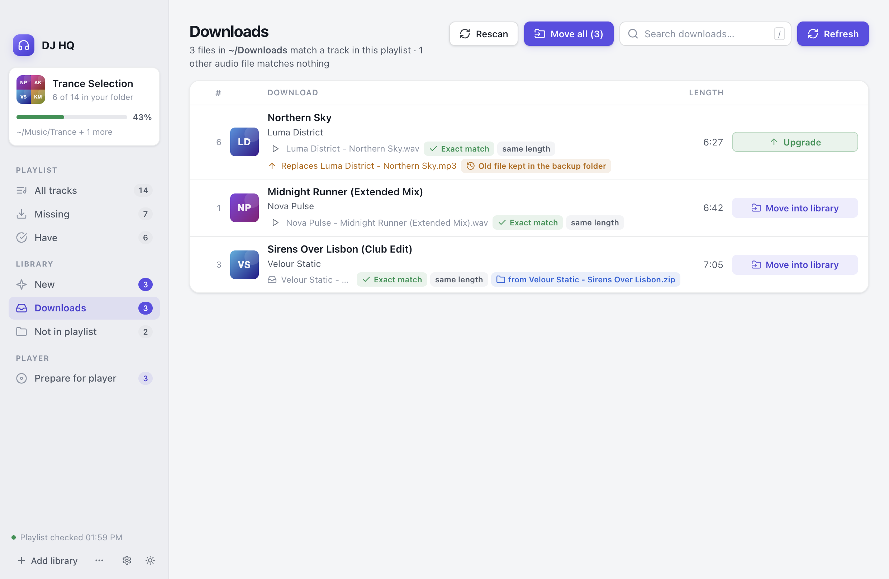

DJ HQ keeps an eye on your Downloads folder. Audio files there are compared
with the playlist the same way your library is, and the ones that match a track
show up here.

1. Check the row: it shows which track the file belongs to, whether the length
   matches, and whether it's an MP3.
2. Click **Move into library**. The file is moved as it is, no renaming, and
   linked to the track. It disappears from Missing and appears in Have.
3. For a lossless download of a track you only had as an MP3, the button reads
   **Upgrade**. The old MP3 goes to the backup folder, not the bin.
4. **Move all** does the whole list at once, after telling you how many files
   are upgrades.

Bandcamp purchases arrive as zips; DJ HQ looks inside them, lists the tracks
that belong to the playlist (tagged "from Album.zip") and unpacks only those,
leaving the zip where it is. Unfinished downloads are ignored; let them finish,
then click **Rescan**. Files that are already in your library by name are
counted but not listed.

With **Move exact matches automatically** turned on in Settings, a download
whose name and length match a track exactly moves into the library on its own
within a minute, and the app tells you. Fuzzy matches and upgrades always wait
for your click.

### Not in playlist: files SoundCloud doesn't know about

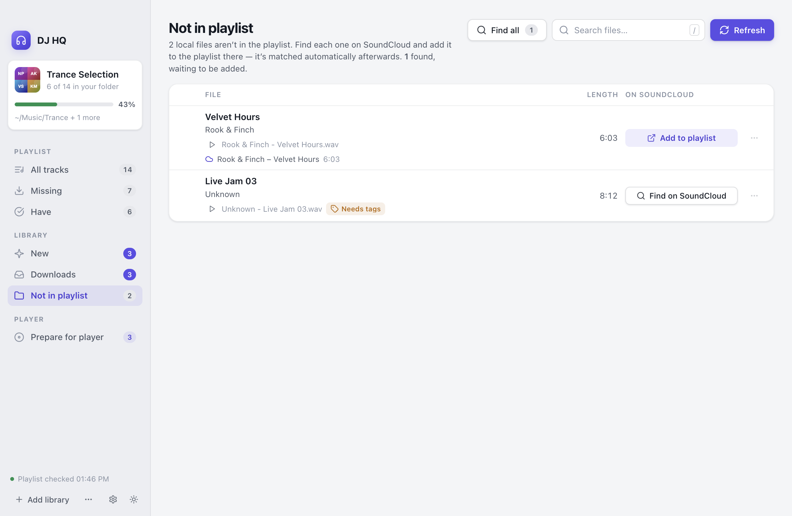

Tracks in your folder that match nothing in the playlist. The idea is to get
them *into* the playlist, so the playlist stays the one list that's always
right.

1. Click **Find all** to search SoundCloud for every file at once. Sure matches
   are accepted automatically; the rest are left for you.
2. For those, click **Find on SoundCloud**. Candidates are listed with their
   length and how well they match; a candidate already in the playlist is
   marked, and picking it links the file to that track. If nothing fits, edit
   the search text: shorter works better, so drop the remix part.
3. Pick a candidate. The row now shows the found track and an **Add to
   playlist** button, which opens it on SoundCloud so you can add it to the
   playlist yourself.
4. On the next refresh the file is matched to its track automatically and
   leaves this list.

<p align="center">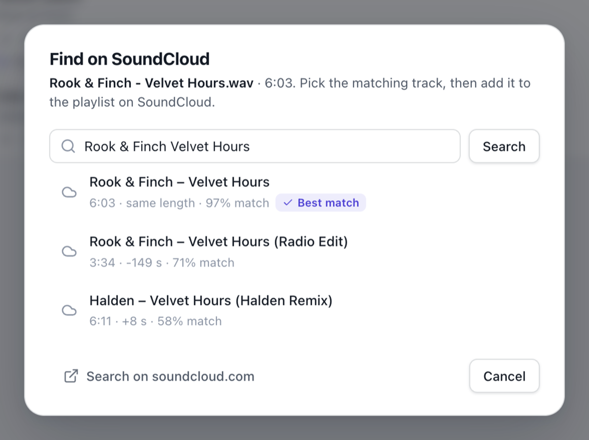</p>

If a file's artist or title is wrong (DJ HQ reads them from the file name),
click **⋯ → Edit artist / title** first; the search and the tags use your
values.

### Prepare for player: tags, conversion and rekordbox

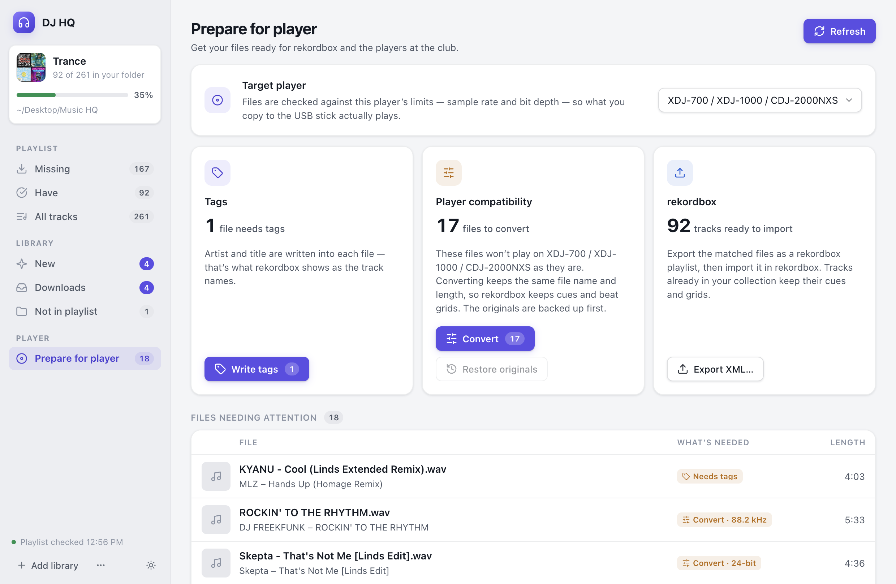

1. **Pick your player** at the top. Everything below adapts to what it can
   play: the XDJ-700 and XDJ-1000 only take 16-bit WAV at 44.1 or 48 kHz, while
   the CDJ-2000NXS2, XDJ-XZ and CDJ-3000 also play 24-bit, 96 kHz and FLAC.
2. **Write tags** writes the artist and title into every file that doesn't have
   them, in the way rekordbox actually reads them (it's picky about WAVs). The
   genre becomes the playlist name.
3. **Convert** turns files your player can't play into ones it can, in place:
   same file name, same length, so rekordbox keeps your hot cues and beat
   grids. The originals are backed up first, and **Restore originals** puts
   them back whenever you like.
4. **Export XML…** writes a rekordbox playlist with every matched file and
   shows you how to import it. In rekordbox: *Preferences → Advanced →
   Database → rekordbox xml*, browse to the file once; a *rekordbox xml* item
   then appears in the tree, and right-clicking the playlist there offers
   **Import Playlist**. Tracks already in your collection keep their cues and
   grids. Export again whenever the playlist changes; the file path stays the
   same.

<p align="center">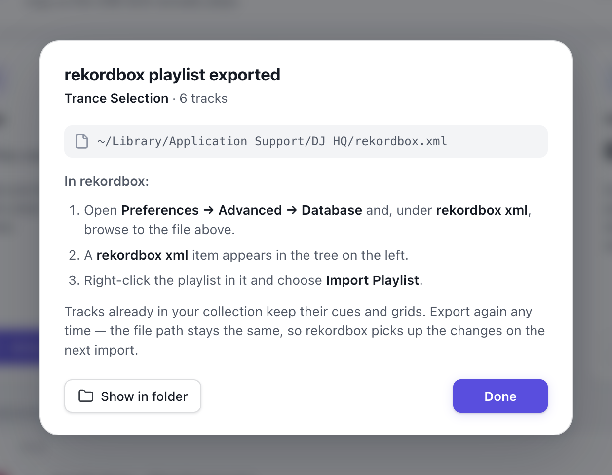</p>

The **Files needing attention** list underneath shows exactly which files still
need tags or conversion before they're ready for the booth, each with its
artwork and a play button.

### Appearance, search and the sidebar

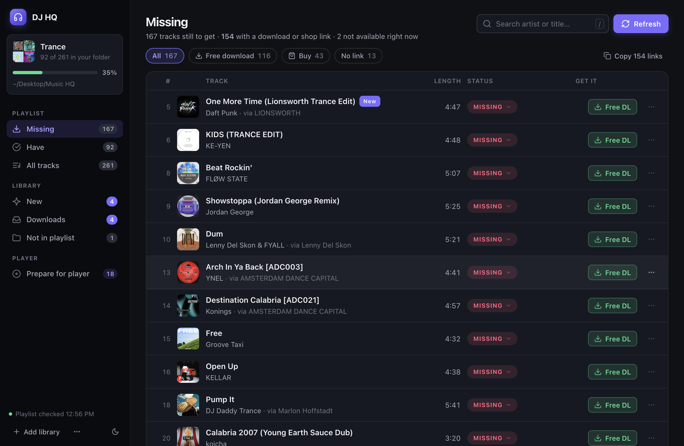

- The sun-and-moon button at the bottom of the sidebar switches between light,
  dark and "follow the system".
- The search box filters the current list by artist, title or file name. Press
  `/` to jump to it.
- The library card at the top of the sidebar shows how many playlist tracks are
  in your folder; the counts next to each list are live. **All tracks** is the
  whole playlist, **Missing** and **Have** split it.
- The **⋯** button at the bottom of the sidebar opens the playlist on
  SoundCloud, rescans the music folder, exports the rekordbox XML, replays the
  tour, checks for updates, and adds or removes libraries. The gear next to it
  opens Settings.

### Settings

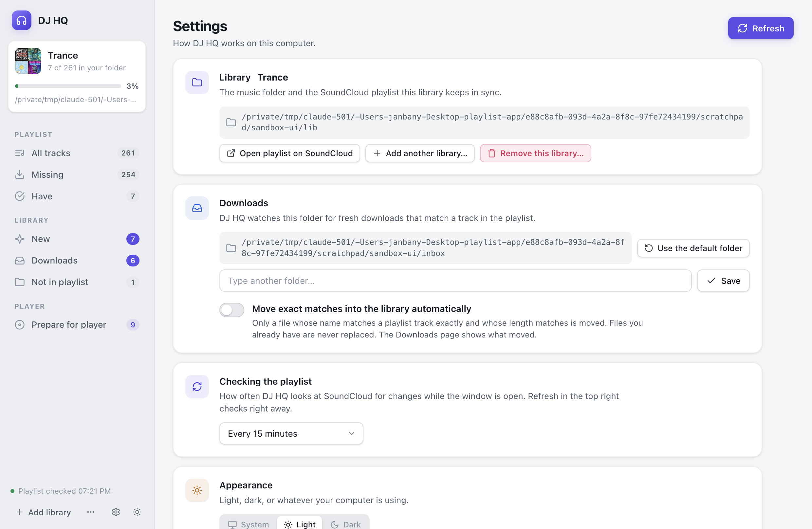

The gear at the bottom of the sidebar. From top to bottom: the library (its
folders, playlist, remove), the Downloads folder DJ HQ watches and the switch
for moving exact matches automatically, how often the playlist is checked,
appearance, backups (how much space the originals of converted files and
replaced MP3s take, with a **Clean up** button once you're sure you won't need
them), and updates.

### More than one folder

A library starts with one folder, but your tracks for a playlist may be spread
over several, or sorted into subfolders. Both work:

- **Add folder** in the library card of Settings adds another folder to the
  library. Files in any of its folders count as yours. The first folder stays
  the *main* one: that is where downloads are moved into. A folder can be
  removed from the library again; its files stay where they are.
- **Include subfolders** also scans the folders inside each library folder.
  It is off unless you turn it on, so a library never picks up more than you
  asked for.

Files outside the main folder are listed with their folder in front, for
example `Deep/Artist – Title.wav` or `Vinyl rips/Artist – Title.wav`, so you
can see where each one lives. Tags, conversion, backups and restore work on
them like on any other file.

### More than one playlist

Click **+ Add library** in the sidebar to link another folder to another
playlist, and switch between libraries from the library name at the top. Each
library keeps its own matches, edits and "new" marks.

## Tips and troubleshooting

- **A match is wrong.** Click the file name under the track and pick the right
  file, or choose *No file*. The status pill lets you set Have or Missing by
  hand.
- **No Free DL or Buy button on a track.** The uploader set no purchase link
  and wrote none in the description. The **⋯** menu still opens the track on
  SoundCloud.
- **Find on SoundCloud finds nothing.** Try shorter search text and drop the
  remix part. Some edits simply aren't on SoundCloud; **⋯ → Search on
  soundcloud.com** opens the site's own search.
- **A download doesn't show up.** Zips and unfinished downloads are ignored:
  unzip, let it finish, then **Rescan**. A file whose name already exists in
  your folder counts as "already in your library".
- **rekordbox still shows the old bit depth after converting.** That column is
  cached. Right-click the track → *Analyze Track* (hot cues survive), or just
  ignore it; playback uses the real file.
- **Tags don't show for tracks already in rekordbox.** Select them →
  right-click → *Reload Tag*.
- **The XML playlist imported but the tracks look unchanged.** A rekordbox
  quirk: importing a playlist doesn't update tracks already in the collection.
  Right-click the tracks inside the *rekordbox xml* node and import those too.
- **"Couldn't load your library: operation not permitted" (macOS).** Give the
  app access to your music folder in System Settings → Privacy & Security →
  Files and Folders.
- **macOS says the app is "damaged" and should go in the Bin.** That happens
  when a download tool strips the app's signature. Download the DMG again with
  Safari or Chrome. If it still says damaged, the one-time Terminal fix is
  `xattr -cr "/Applications/DJ HQ.app"`.

## Your files and your data

**DJ HQ is careful with your files.** Tag writes copy the audio bit for bit and
verify it before replacing the file; on any doubt the original stays untouched.
Conversions back up the original first and verify the length afterwards, and
backups are never deleted. Moving a download is a real move, not a
copy-and-forget. Keep your own backups anyway: it's your library.

**Where things live.** The app keeps its data in the OS user-data folder,
`~/Library/Application Support/DJ HQ` on macOS and `%APPDATA%\DJ HQ` on
Windows. Running from source uses the project folder instead. In there:

| | |
| --- | --- |
| `state.json` | libraries, playlist snapshots, manual matches, edits, "new" marks |
| `originals/<library>/` | originals backed up before a conversion |
| `originals/<library>/replaced/` | MP3s replaced by a lossless download |
| `rekordbox.xml` | the last rekordbox export |
| `prefs.json` | appearance, "tour seen", dismissed update notices |

**About SoundCloud.** There's no API key or login: the app reads the same
public endpoints the SoundCloud web player uses. That works today and may break
whenever SoundCloud changes their site. Only public playlists work, and the app
never writes to SoundCloud; adding a track to the playlist is something you do
there, logged in as yourself. The app fetches the playlist on launch, every
15 minutes while the window is open, and when you press Refresh; a track search
runs only when you use Find on SoundCloud or Find all.

## Technical details

### Run from source

Needs [Node.js](https://nodejs.org) 20 or newer.

```
git clone https://github.com/Banneh/playlist-app.git
cd playlist-app
npm install
npm start
```

### Headless mode

The same interface in your browser, without the Electron window:

```
npm run headless        # then open http://localhost:8765
```

`DJHQ_PORT` and `DJHQ_DATA_DIR` override the port and the data folder.
*Show in folder* and the native folder picker only exist in the desktop app.

### Project layout

```
npm run build       # compile TypeScript to dist/
npm start           # build + open the Electron app
npm run headless    # build + serve the UI at http://localhost:8765
npm run dist        # build installers locally into release/
```

| Path | What it is |
| --- | --- |
| `src/core.ts` | state, SoundCloud access, matching, link classification, tagging, conversion, inbox, export |
| `src/server.ts` | the HTTP API and the static UI files |
| `src/main.ts` | the Electron shell |
| `src/id3.ts` | ID3v2.3 / RIFF tag writer |
| `web/app.css` | design tokens and components for the light and dark themes |
| `web/app.js` | the UI shell: sidebar, routing, menus, dialogs |
| `web/pages/` | one file per page |
| `web/tour.js` · `web/demo.js` | the guided tour and its sample data |
| `web/player.js` | the preview player |
| `src/zip.ts` | minimal zip reader for Bandcamp downloads |
| `scripts/afterPack.js` | ad-hoc signs the macOS app after packaging |
| `scripts/screenshots.js` | regenerates the README screenshots from sample data (`npm run screens`) |

The UI is plain HTML, CSS and JavaScript with no build step. File-mutating
requests are queued and run one at a time.

The screenshots in this README come from `npm run screens`: it builds a
throw-away home folder with a sample library (real audio files, made-up
artists), runs the app against it and captures every screen, so nobody's
actual collection ends up in the pictures.

### HTTP API

Every call returns the full view (what the UI renders) unless noted. POST
bodies are JSON.

| Call | Body | Does |
| --- | --- | --- |
| `GET /api/state` | | current view |
| `GET /api/app` | | app version, platform and whether it runs packaged (not a view) |
| `POST /api/refresh` | | fetch the playlist, then the view |
| `POST /api/rescan` | | rescan the library folders |
| `POST /api/library` | `{op: "add", dir, url}` · `{op: "select", id}` · `{op: "remove", id}` · `{op: "add_folder", dir}` · `{op: "remove_folder", dir}` · `{op: "subfolders", on}` | manage libraries and their folders (the folder ops take an optional `id`, default: the active library) |
| `POST /api/device` | `{device}` | target player (`xdj-700`, `nxs2`, `cdj-3000`) |
| `POST /api/settings` | `{inbox_dir?, auto_move?, refresh_min?}` | downloads folder (`""` = default), auto-move, check interval in minutes |
| `GET /api/file?path=` | | streams a local audio file for the preview (library and downloads folders only) |
| | | file keys (`file`, `name`) are relative to the library folder, `/`-separated; files of an extra folder carry its name in front |
| `POST /api/clean-backups` | | deletes the active library's backups (adds `clean_report`) |
| `POST /api/override` | `{id, status: "have" \| "missing" \| "na" \| null}` | status override / not available now |
| `POST /api/assign` | `{id, file}` (`""` = no file, `null` = automatic) | pin a file to a track |
| `POST /api/edit` | `{id, artist, title}` or `{file, artist, title}` | artist/title edit (track or local file) |
| `POST /api/seen` | | mark all as seen |
| `POST /api/tag` · `/api/convert` · `/api/restore` | | write tags / convert / restore originals (adds a report) |
| `POST /api/find` | `{file, q?}` | SoundCloud candidates for a local file (not a view) |
| `POST /api/found` | `{file, track \| null}` | remember / forget the picked track |
| `POST /api/find-all` | | search every unresolved file, accept sure matches |
| `POST /api/inbox` | | downloads that match the playlist, including tracks inside zips (not a view; carries `moved` when auto-move acted) |
| `POST /api/inbox-move` · `/api/inbox-move-all` | `{file, id, zip?}` · | move downloads into the library (unpacks from a zip when `zip` is given) |
| `POST /api/export-xml` | | write `rekordbox.xml` (returns path and counts) |
| `POST /api/reveal` · `/api/pick-folder` | `{path}` · | Electron only |

### Releases

Pushing a `v*` tag makes GitHub Actions build the installers on macOS (Apple
Silicon and Intel), Windows and Linux and publish them to the Releases page.
The macOS apps are ad-hoc signed; they aren't notarized, hence the one-time
"Open Anyway" step above.

### Out of scope

Spotify and Apple Music playlists, private playlists (needs OAuth), writing to
SoundCloud playlists, automated downloading through gates, and editing the
rekordbox database. Issues and PRs welcome.

## License

MIT — see [LICENSE](LICENSE).
