# DJ HQ

[English](README.md) · **Polski**

**Folder z muzyką zgodny z playlistą na SoundCloud, a utwory gotowe dla rekordbox i na klub.**

**[Strona pobierania →](https://banneh.github.io/dj-hq-site/)** wybiera instalator pasujący do twojego komputera i prowadzi przez pierwsze uruchomienie.

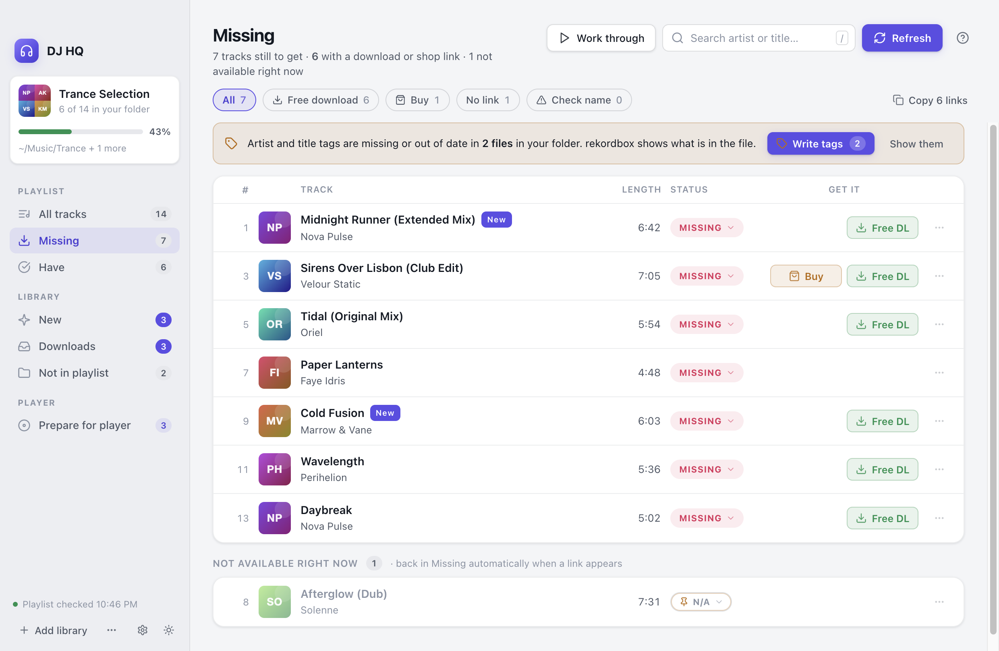

DJ HQ to darmowa aplikacja na komputer dla DJ-ów, którzy zbierają muzykę przez
playlisty na SoundCloud. Porównuje playlistę z folderem, w którym trzymasz
utwory, pokazuje, czego jeszcze brakuje i gdzie to zdobyć, porządkuje pliki,
które już masz, tak żeby rekordbox i odtwarzacze Pioneer nie miały zastrzeżeń,
a na koniec daje ci gotową playlistę rekordbox. Sam SoundCloud jest w aplikacji
na stronie **Discover**, więc możesz słuchać i jednym kliknięciem dodawać do
playlisty to, co ci się podoba. Wszystko działa na twoim komputerze; nic nie
jest nigdzie wysyłane.

Aplikacja działa po polsku i po angielsku: domyślnie w języku twojego systemu,
a zmienisz to w **Ustawienia → Język**.

## Spis treści

- [Co robi DJ HQ](#co-robi-dj-hq)
- [Instalacja](#instalacja)
  - [Pobieranie](#pobieranie)
  - [Pierwsze uruchomienie](#pierwsze-uruchomienie)
  - [Aktualizacje](#aktualizacje)
- [Pierwsze kroki](#pierwsze-kroki)
- [Korzystanie z DJ HQ](#korzystanie-z-dj-hq)
  - [Brakujące: utwory, których jeszcze potrzebujesz](#brakujące-utwory-których-jeszcze-potrzebujesz)
  - [Mam: utwory, które już są w twoim folderze](#mam-utwory-które-już-są-w-twoim-folderze)
  - [Discover: SoundCloud w aplikacji](#discover-soundcloud-w-aplikacji)
  - [Twoje polubienia](#twoje-polubienia)
  - [Nowe: co się zmieniło od ostatniego razu](#nowe-co-się-zmieniło-od-ostatniego-razu)
  - [Pobrane: nowe pliki do biblioteki](#pobrane-nowe-pliki-do-biblioteki)
  - [Spoza playlisty: pliki, których SoundCloud nie zna](#spoza-playlisty-pliki-których-soundcloud-nie-zna)
  - [Przygotuj na odtwarzacz: tagi, konwersja i rekordbox](#przygotuj-na-odtwarzacz-tagi-konwersja-i-rekordbox)
  - [Wygląd, wyszukiwanie i pasek boczny](#wygląd-wyszukiwanie-i-pasek-boczny)
  - [Ustawienia](#ustawienia)
  - [Więcej niż jeden folder](#więcej-niż-jeden-folder)
  - [Więcej niż jedna playlista](#więcej-niż-jedna-playlista)
  - [Inny komputer albo kopia zapasowa](#inny-komputer-albo-kopia-zapasowa)
- [Wskazówki i rozwiązywanie problemów](#wskazówki-i-rozwiązywanie-problemów)
- [Twoje pliki i twoje dane](#twoje-pliki-i-twoje-dane)
- [Szczegóły techniczne (po angielsku)](README.md#technical-details)
- [Licencja](#licencja)

## Co robi DJ HQ

*Biblioteka* w DJ HQ to folder z muzyką (albo kilka folderów) połączony z jedną
playlistą na SoundCloud: publiczną albo prywatną, przez jej link udostępniania.
Aplikacja wczytuje playlistę, skanuje foldery i ustala, który plik należy do
którego utworu, porównując nazwy i długości. Wszystko inne opiera się na tym:

- **Brakujące** wypisuje każdy utwór z playlisty, którego jeszcze nie ma
  w twoim folderze, z przyciskiem **Za darmo** albo **Kup**, który prowadzi
  prosto do bramki pobierania albo do sklepu. Linki są szukane w przycisku
  pobierania utworu *i* w jego opisie.
- **Mam** pokazuje plik każdego utworu, który masz, i oznacza
  wszystko, co jeszcze wymaga tagów, konwersji albo można podmienić z MP3 na
  plik bezstratny.
- **Nowe** zbiera utwory dodane do playlisty i pliki, które trafiły do twojego
  folderu od ostatniego razu.
- **Pobrane** obserwuje twój folder Pobrane i jednym kliknięciem przenosi nowe
  pliki do biblioteki, bez zmiany nazw. DJ HQ zagląda do archiwów zip
  z Bandcamp, a dokładne dopasowania mogą trafiać do biblioteki same.
- **Spoza playlisty** znajduje utwór na SoundCloud dla plików, których jeszcze
  nie ma na playliście, żeby można było je tam dodać.
- **Przygotuj na odtwarzacz** zapisuje tagi wykonawcy i tytułu tak, jak czyta
  je rekordbox, konwertuje pliki, których twój odtwarzacz Pioneer nie odtworzy
  (w tym samym miejscu, więc punkty cue przetrwają), i eksportuje playlistę
  rekordbox.
- **Discover** to soundcloud.com w aplikacji: zaloguj się tam raz, słuchaj
  tego, co proponuje SoundCloud, i jednym kliknięciem dodawaj do playlisty albo
  polubień to, co ci się podoba. Kliknięcie okładki w dowolnym miejscu DJ HQ odtwarza tam utwór.
- **Twoje polubienia** porównuje każdy utwór polubiony na SoundCloud z twoimi
  folderami i pokazuje, co jeszcze trzeba zdobyć.
- Każdy plik można **odsłuchać** w aplikacji, a biblioteka może zamiast
  playlisty śledzić twoje **polubienia** na SoundCloud.

Playlista jest sprawdzana ponownie co 15 minut, gdy okno jest otwarte, i za
każdym razem, gdy klikniesz **Odśwież**. DJ HQ zapisuje coś na SoundCloud tylko
wtedy, gdy poprosisz o to na stronie Discover, gdzie logujesz się na własne konto;
cała reszta czyta tylko to, co widzi każdy z linkiem, i nie wymaga logowania.

## Instalacja

### Pobieranie

Najprościej przez [stronę pobierania](https://banneh.github.io/dj-hq-site/):
rozpoznaje twój komputer i proponuje właściwy plik. Możesz też pobrać najnowszą
wersję ze [strony Releases](https://github.com/Banneh/playlist-app/releases):

| Twój komputer | Plik do pobrania |
| --- | --- |
| Mac z Apple Silicon (M1 lub nowszy) | `DJ-HQ-<version>-mac-arm64.dmg` |
| Mac z procesorem Intel | `DJ-HQ-<version>-mac-x64.dmg` |
| Windows | `DJ-HQ-Setup-<version>.exe` |
| Linux | `DJ-HQ-<version>.AppImage` |

> [!TIP]
> Nie wiesz, jakiego masz Maca? Kliknij menu Apple → **Ten Mac**. Jeśli widać
> *Czip: Apple M…*, potrzebujesz pliku dla Apple Silicon; jeśli
> *Procesor: Intel…*, pliku dla Intela.

Nic więcej nie trzeba instalować; ffmpeg jest w zestawie.

### Pierwsze uruchomienie

Aplikacja DJ HQ nie jest podpisana certyfikatem dewelopera Apple ani Microsoftu (są
płatne), więc komputer raz poprosi cię o potwierdzenie, że ufasz aplikacji.
Terminal nie jest potrzebny.

**macOS 15 (Sequoia) lub nowszy**

1. Otwórz plik DMG, przeciągnij **DJ HQ** do folderu **Aplikacje** i kliknij dwa razy.
   macOS powie, że nie może zweryfikować aplikacji. Kliknij **Gotowe**.
2. Otwórz **Ustawienia systemowe → Prywatność i ochrona** i przewiń w dół do
   sekcji *Ochrona*. Obok komunikatu o zablokowaniu „DJ HQ” kliknij **Otwórz
   mimo to**.
3. Potwierdź hasłem albo Touch ID. Od tej chwili aplikacja otwiera się jak
   każda inna.

**macOS 14 (Sonoma) lub starszy**

Kliknij **DJ HQ** w folderze Aplikacje prawym przyciskiem (albo z klawiszem Control),
wybierz **Otwórz**, a potem kliknij **Otwórz** w oknie. Wystarczy raz.

**Windows**

SmartScreen powie, że ochronił twój komputer. Kliknij **Więcej informacji**,
a potem **Uruchom mimo to**.

### Aktualizacje

DJ HQ raz dziennie sprawdza w serwisie GitHub, czy jest nowsza wersja. Gdy jest, na
dole paska bocznego pojawia się mała informacja z przyciskiem **Pobierz** dla
twojego komputera. Zainstaluj nową wersję w miejsce starej; biblioteka i ustawienia
zostają tam, gdzie były. **⋯ → Sprawdź aktualizacje…** sprawdza od razu.

## Pierwsze kroki

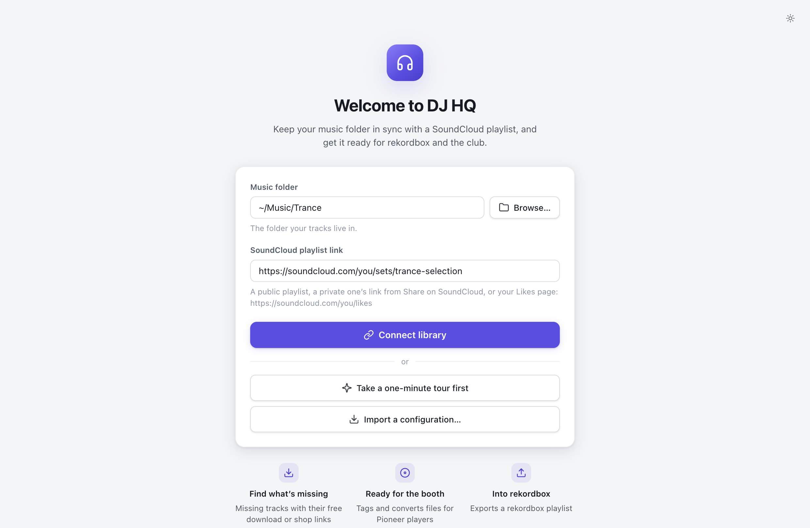

1. Kliknij **Przeglądaj…** i wybierz folder, w którym trzymasz utwory (albo
   wpisz ścieżkę).
2. Wklej link do swojej playlisty na SoundCloud. Adres publicznej playlisty
   działa bez zmian. Dla prywatnej playlisty otwórz na SoundCloud jej
   udostępnianie (**Share**) i wklej ten link (kończy się na `/s-` i kodzie);
   każdy, kto ma ten link, widzi playlistę, więc zachowaj go dla siebie. Jeśli
   zamiast tego zbierasz muzykę przez polubienia, wklej adres swojej strony
   polubień (`https://soundcloud.com/you/likes`); działa tak samo.
3. Kliknij **Połącz bibliotekę**.

DJ HQ wczytuje playlistę, skanuje folder i dopasowuje pliki do utworów. Przy
kilkuset utworach trwa to kilka sekund. Jeśli SoundCloud nie udostępni niektórych
utworów (usuniętych, zablokowanych w twoim kraju albo prywatnych
i nieudostępnionych przez link), wiersz stanu powie, ilu nie udało się odczytać.

Żeby później skierować bibliotekę na inny link, na przykład po ustawieniu jej
playlisty jako prywatnej, użyj **Ustawienia → Zmień link…**. Nowy link jest
najpierw wczytywany; twoje dopasowania, zmienione nazwy i oznaczenia nowości zostają,
a jeśli nowego linku nie da się odczytać, zostaje stary. Jeśli pod nowym
linkiem brakuje utworów, które ma biblioteka (inna playlista albo utwory,
których nie da się odczytać), DJ HQ mówi, ilu, i pyta, zanim cokolwiek zmieni,
bo te utwory znikną z biblioteki razem z dopasowaniami.

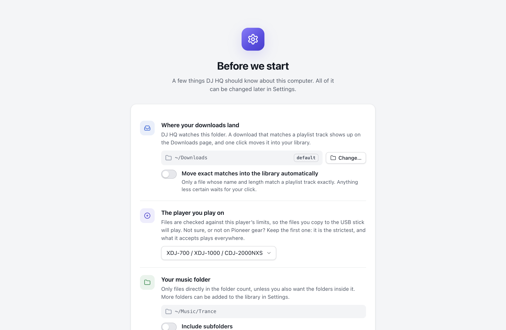

Za pierwszym razem ekran **Zanim zaczniemy** pyta o podstawy: do którego
folderu trafiają pobrane pliki i czy dokładne dopasowania mogą same trafiać do
biblioteki, na jakim odtwarzaczu grasz, czy foldery wewnątrz folderu z muzyką
też się liczą, jasny czy ciemny wygląd i jaki język. Każde z tych pytań ma
rozsądną wartość domyślną, więc **Zaczynamy** to dobra odpowiedź; wszystko
można potem zmienić w Ustawieniach.

Trafiasz na listę **Brakujące**, a pasek boczny pokazuje, jaka część playlisty
jest już w twoim folderze.

Za pierwszym razem DJ HQ proponuje minutowe oprowadzanie, które pokazuje, do
czego służy każda lista. Działa na kilku przykładowych utworach, więc możesz
je obejrzeć, zanim cokolwiek połączysz (na ekranie powitalnym jest do tego
przycisk), i nic w twojej bibliotece się nie zmieni. Kliknij **Nie teraz**,
żeby je pominąć; **⋯ → Oprowadź mnie** powtarza je w każdej chwili.

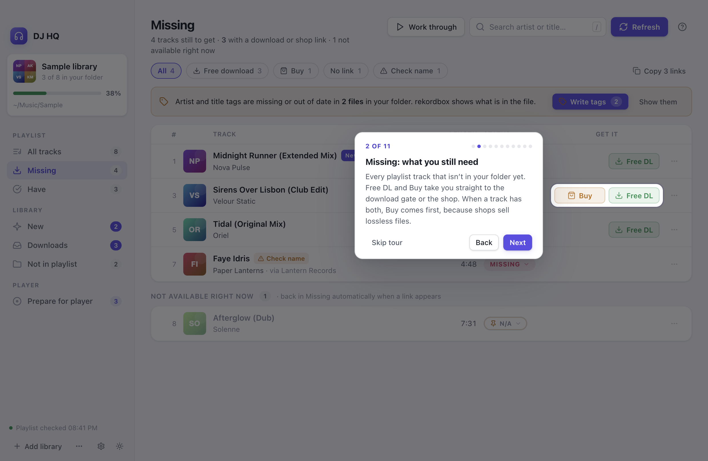

> [!NOTE]
> Na tym etapie nic nie jest przemianowywane, przenoszone ani nadpisywane.
> DJ HQ tylko czyta twój folder, dopóki nie poprosisz o zapisanie tagów,
> konwersję pliku albo przeniesienie pobranego pliku.

## Korzystanie z DJ HQ

### Brakujące: utwory, których jeszcze potrzebujesz

Na tej liście spędzisz najwięcej czasu: każdy utwór z playlisty, którego nie
ma w twoim folderze, z najszybszym sposobem, żeby go zdobyć.

- **Za darmo** to darmowe pobieranie: bramka w stylu Hypeddit, plik
  udostępniony na Dysku Google albo w Dropboksie, albo przycisk pobierania
  samego SoundCloud.
- **Kup** to sklep: Bandcamp, Beatport, Juno, Traxsource i podobne. Gdy utwór
  ma oba linki, „Kup” jest pierwszy, bo sklepy sprzedają pliki bezstratne,
  a darmowe pobieranie to często MP3. Najedź na przycisk, żeby zobaczyć, dokąd
  prowadzi.

**Jak przejść przez listę**

1. Zawęź listę filtrami nad nią: utwory z darmowym pobieraniem, z linkiem do
   sklepu albo bez żadnego linku.
2. Kliknij **Za darmo** albo **Kup**. Link otworzy się w przeglądarce; plik
   jak zwykle trafi do folderu Pobrane.
3. Gdy pobierze się kilka plików, przejdź na pasku bocznym do **Pobrane**
   i stamtąd przenieś je do biblioteki (zobacz niżej).

**Długa lista po kolei**

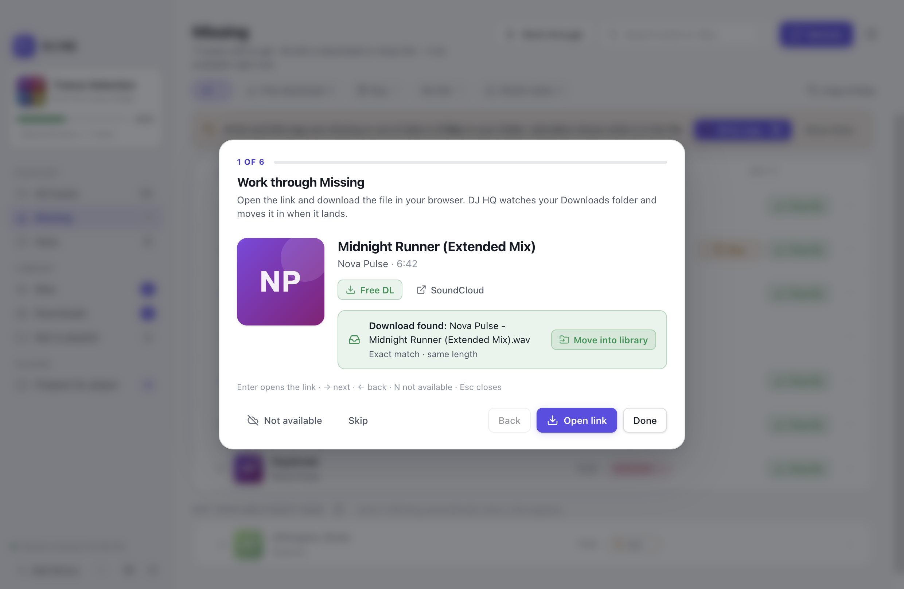

**Przejdź po kolei** (w prawym górnym rogu) pokazuje listę po jednym utworze:
okładka, linki i obserwowanie folderu Pobrane. Otwórz link, pobierz plik
w przeglądarce, a gdy się pojawi, DJ HQ zaproponuje **Przenieś do biblioteki**
i przejdzie do następnego utworu. Enter otwiera link, strzałki przechodzą
między utworami, N odkłada utwór jako niedostępny, Esc zamyka.

**Co jeszcze można tu zrobić**

- **Kopiuj linki** kopiuje do schowka każdy utwór widoczny na ekranie jako
  „Wykonawca – Tytuł, link”, po jednym w wierszu. Przydaje się na zakupy.
- Kliknij status utworu, żeby zmienić go ręcznie. **Teraz niedostępny na
  SoundCloud** odkłada utwór do osobnej sekcji na dole; wraca sam, gdy tylko
  pojawi się dla niego link. **Przywróć ustawienie automatyczne** cofa każdy status
  ustawiony ręcznie.
- **⋯** na końcu wiersza otwiera utwór na SoundCloud, kopiuje jego linki,
  ręcznie dopasowuje plik albo pozwala poprawić wykonawcę i tytuł.
- Kliknij okładkę, żeby otworzyć utwór na SoundCloud.

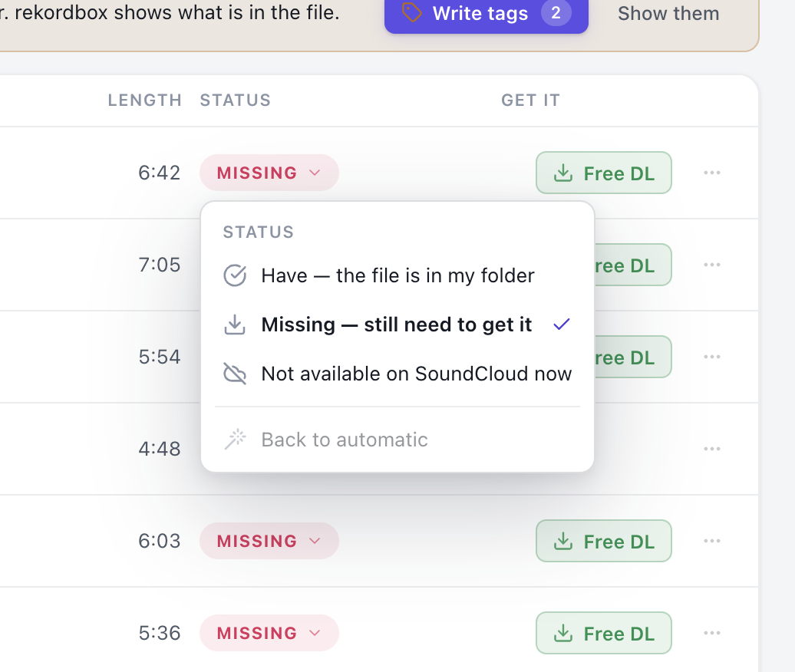

### Mam: utwory, które już są w twoim folderze

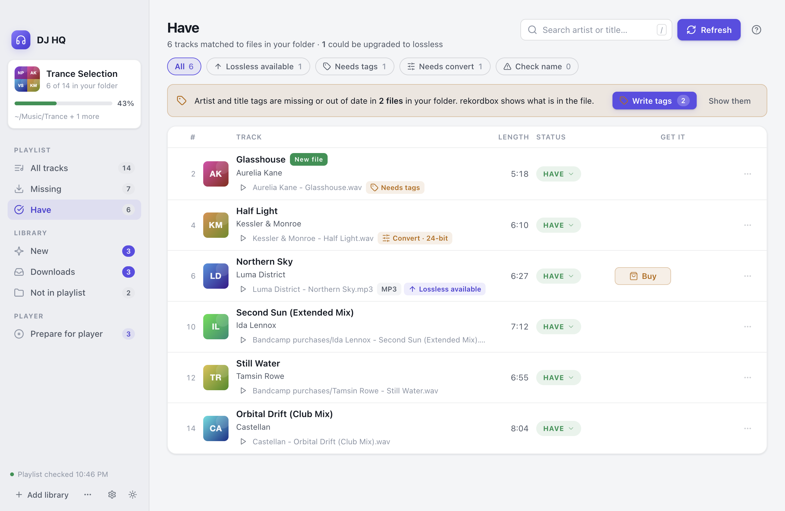

Każdy utwór pokazuje plik, do którego go dopasowano, i małe oznaczenie, gdy
coś wymaga uwagi:

| Oznaczenie | Znaczenie |
| --- | --- |
| **Wymaga tagów** | Wykonawcy i tytułu w pliku brakuje albo różnią się od pokazanej nazwy, na przykład po zamianie lub edycji. |
| **Do konwersji · 24 bity** (albo 88,2 kHz, …) | Wybrany odtwarzacz nie odtworzy tego pliku w tej postaci. |
| **MP3** | Plik stratny. |
| **Dostępny bezstratny** | Masz plik MP3, a link do sklepu prowadzi do wersji bezstratnej. |
| **Dopasowany ręcznie** | Ten plik wybrano ręcznie. |
| **Sprawdź nazwę** | Wykonawca i tytuł mogą być zamienione miejscami albo podzielone w złym miejscu. Widoczne na każdej liście, także przy utworach, których jeszcze nie masz. |

Filtry **Wymaga tagów**, **Do konwersji** i **Dostępny bezstratny**
nad listą pokazują tylko takie utwory, a liczniki na kartach strony Przygotuj
na odtwarzacz otwierają te same filtry. Dopóki jakiś plik wymaga tagów,
informacja nad playlistą mówi, ile ich jest, i od razu proponuje **Zapisz
tagi**, więc nie trzeba w tym celu przechodzić do Przygotuj na odtwarzacz.
Plik, który wymaga tego samego, ale nie jest na playliście, jest wymieniony
pod listą, z linkiem do strony Spoza playlisty.

Mały przycisk odtwarzania przed nazwą pliku włącza odsłuch w aplikacji; na
dole pojawia się pasek odtwarzania z osią czasu, którą można kliknąć albo
przeciągnąć, i wyciszeniem. To ten sam pasek, który pokazuje utwór grany na
SoundCloud, więc odtwarzacz jest zawsze jeden. Ten sam przycisk jest w oknie
dopasowania, więc niepewne dopasowanie można sprawdzić na słuch.

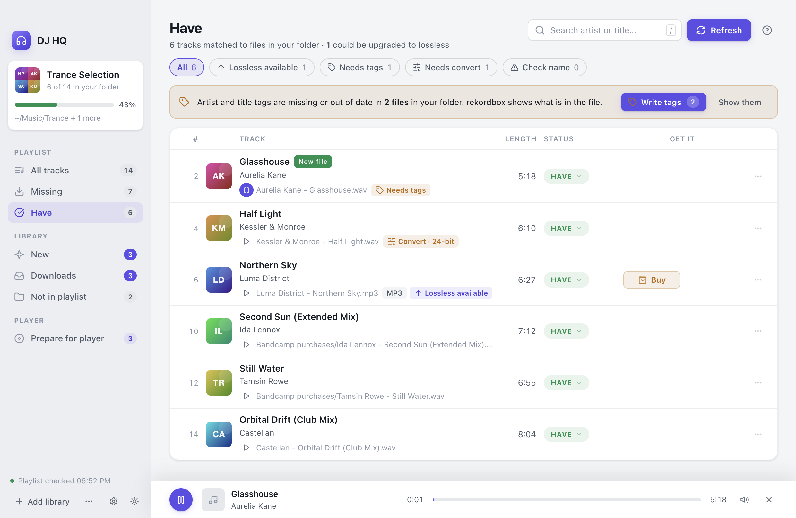

**Jak poprawić złe dopasowanie**

1. Kliknij nazwę pliku pod utworem albo wybierz **⋯ → Dopasuj do pliku
   lokalnego…**.
2. Wybierz właściwy plik. Najbardziej prawdopodobne są na początku; pliki
   dopasowane już do innego utworu są oznaczone, a wybranie takiego zwalnia
   tamten utwór do ponownego dopasowania.
3. Wybierz **Bez pliku**, jeśli utworu w ogóle nie ma w twoim folderze, albo
   **Dopasuj automatycznie**, żeby plik został dobrany automatycznie od nowa.

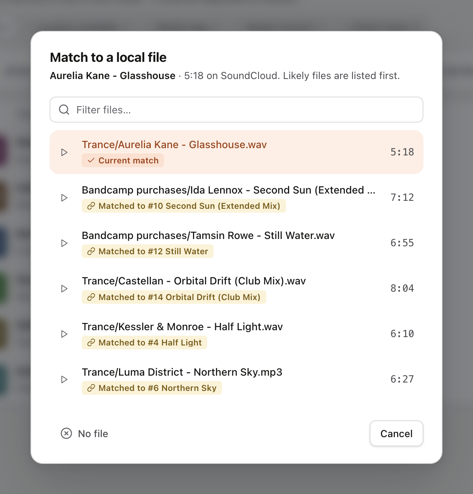

### Discover: SoundCloud w aplikacji

**Discover** to soundcloud.com w DJ HQ. Zaloguj się tam raz, tak jak
w przeglądarce (sesja należy do SoundCloud i zostaje na tym komputerze),
słuchaj tego, co proponuje SoundCloud, i dodawaj do playlisty to, co ci się podoba,
z paska nad stroną, bez wyskakującego okna przy każdym utworze.

Pasek pokazuje utwór, który gra w odtwarzaczu SoundCloud, z okładką, długością
i informacją, czy jest już na playliście:

- **Dodaj do playlisty** dodaje go do playlisty na SoundCloud, więc od razu
  trafia na stronę Brakujące. W bibliotece, która śledzi twoje polubienia, Dodaj
  zamiast tego dodaje utwór do polubień.
- **Serce** dodaje utwór do polubień albo cofa polubienie. Gdy w Ustawieniach
  jest włączone **Dodawaj też do polubień utwory dodawane do playlisty**, dodany utwór trafia
  też do polubień, więc zostaje w nich ślad wszystkiego, co wybrano.
- **Podobne utwory** otwiera to, co SoundCloud proponuje po nim. **Wstecz**,
  **Główna** i **Playlista** poruszają się po stronie.

Odtwarzacz z paska reaguje też na klawiaturę, niezależnie od tego, czy
ostatnio kliknięto pasek, czy stronę SoundCloud (o ile nie piszesz w polu
tekstowym):

| Klawisz | Działanie |
| --- | --- |
| `Spacja` | odtwórz / pauza |
| `←` `→` | 10 sekund wstecz / do przodu |
| `N` `P` | następny / poprzedni utwór w kolejce SoundCloud |
| `A` | dodaj grający utwór do playlisty (w bibliotece polubień: do polubień) |
| `L` | polub go / cofnij polubienie |

Odtwarzacz z Discover obsługuje też resztę aplikacji. Kliknij okładkę utworu
na dowolnej liście, a zacznie grać na SoundCloud, podczas gdy ty zostajesz na
liście; pasek na dole okna pokazuje utwór z przyciskami odtwórz/pauza,
poprzedni i następny, sercem i **Dodaj do playlisty**, a jego przycisk
**Discover** otwiera stronę, na której jest utwór. Działają tam te same
klawisze. Wyjście z Discover w trakcie odtwarzania nie przerywa muzyki,
a sterowanie przejmuje pasek; jego **×** pauzuje i ukrywa odtwarzanie. Menu
**⋯** wiersza ma też **Odtwórz**, **Otwórz na Discover** i **Podobne utwory na
Discover**. Mała strzałka, która pojawia się obok tytułu po najechaniu,
otwiera utwór w przeglądarce. Wolisz do wszystkiego przeglądarkę? Przełącz
**Otwieranie utworów** w Ustawieniach, a strzałka zmieni się w przycisk
odtwarzania na SoundCloud w aplikacji.

Po zalogowaniu **Dodaj do playlisty** na stronie Spoza playlisty to
też jedno kliknięcie, zamiast wycieczki na stronę. **Wyloguj się…**
w Ustawieniach usuwa sesję.

Od czasu do czasu ochrona SoundCloud przed botami prosi o udowodnienie, że
jesteś człowiekiem, i pokazuje na stronie weryfikację (captcha). Dopóki nie
zostanie rozwiązana, nic, co idzie przez Discover, nie działa: utwory nie
startują z twoich list, a Dodaj i serce zawodzą. DJ HQ to zauważa i na każdej
innej stronie pokazuje informację z przyciskiem **Otwórz Discover**; rozwiąż
tam weryfikację, a informacja sama zniknie. W tym czasie te działania od razu
o tym mówią, zamiast czekać.

Discover wymaga aplikacji na komputer. W karcie przeglądarki (tryb headless)
strona o tym mówi, a soundcloud.com otwierasz wtedy obok DJ HQ.

### Twoje polubienia

Każdy utwór polubiony przez zalogowane konto SoundCloud, porównany z plikami
we wszystkich twoich bibliotekach. **Do zdobycia** wypisuje polubione utwory,
których nie ma w żadnym z twoich folderów, z tymi samymi linkami Za darmo
i Kup co na stronie Brakujące. **W twoich folderach** to te, które już masz:
przez playlistę, przez znaleziony plik albo przez plik o tej samej nazwie
i długości w dowolnej bibliotece. **Spoza playlisty** to te, których brakuje
na aktywnej playliście, każdy z przyciskiem **Dodaj**. Lista jest
przechowywana przez kilka minut; **Odśwież** czyta ją ponownie z SoundCloud.
Biblioteka, która śledzi twoje polubienia, z definicji jest tą listą, więc
przycisk Dodaj jest tam ukryty.

### Nowe: co się zmieniło od ostatniego razu

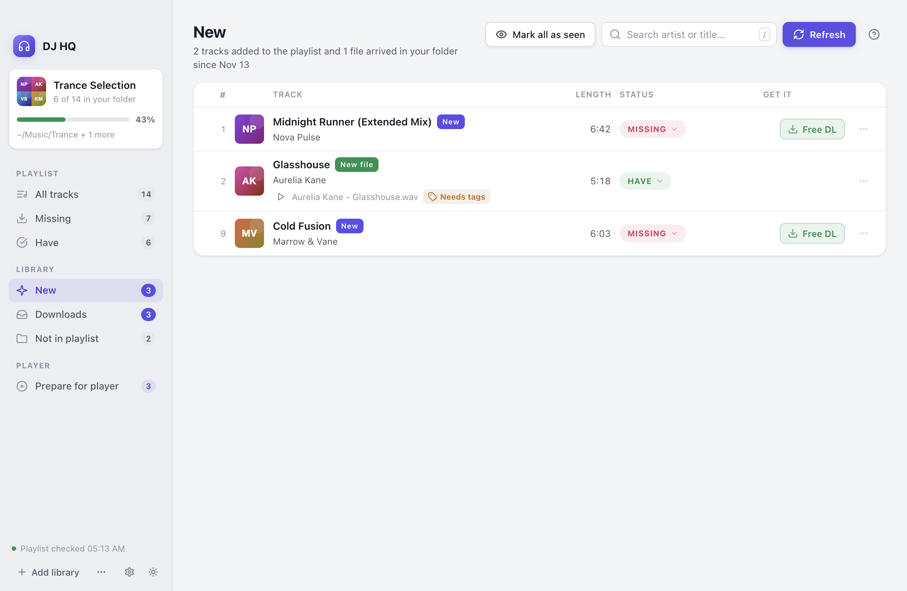

Utwory dodane do playlisty (**Nowy**) i pliki, które trafiły do twojego
folderu (**Nowy plik**), zbierają się tutaj, dopóki nie klikniesz **Oznacz
wszystko jako przejrzane**. Traktuj to jako listę zadań: zapisanie tagów,
konwersja i import do rekordbox. Gdy odświeżanie znajdzie zmiany, krótka
informacja mówi, ile utworów dodano albo usunięto.

### Pobrane: nowe pliki do biblioteki

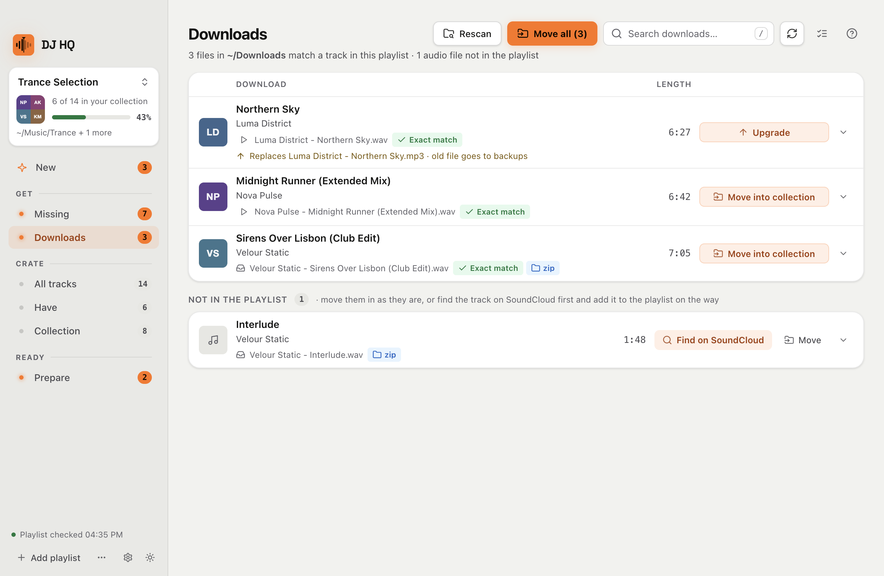

DJ HQ obserwuje twój folder Pobrane. Pliki audio w nim są porównywane
z playlistą tak samo jak twoja biblioteka, a te, które pasują do utworu,
pojawiają się tutaj.

1. Sprawdź wiersz: pokazuje, do którego utworu należy plik, czy zgadza się
   długość i czy jest to plik MP3.
2. Kliknij **Przenieś do biblioteki**. Plik jest przenoszony bez zmian, bez
   zmiany nazwy, i łączony z utworem. Znika ze strony Brakujące i pojawia się na stronie Mam.
3. Dla bezstratnego pliku do utworu, który był tylko w MP3, przycisk brzmi
   **Podmień na bezstratny**. Stary plik MP3 trafia do folderu kopii
   zapasowych, nie do kosza.
4. **Przenieś wszystkie** przenosi całą listę naraz, po informacji, ile z tych
   plików to podmiany na bezstratne.

Pliki audio, które nie pasują do żadnego utworu z playlisty, są wypisane
niżej, w sekcji **Spoza playlisty**. **Przenieś** przenosi taki plik bez zmian
do twojej biblioteki, gdzie wyłapie go strona Spoza playlisty. **Znajdź na
SoundCloud** najpierw szuka utworu: wybierz właściwy wynik, a plik trafi do
biblioteki dopasowany do niego, a przy zaznaczonym polu (po zalogowaniu na
Discover) utwór w tym samym kroku trafi na playlistę na SoundCloud, więc od
razu pojawi się w Mam. Wynik, który już jest na playliście, po prostu staje się
plikiem tego utworu.

Zakupy z Bandcamp przychodzą jako archiwa zip; DJ HQ zagląda do nich,
wypisuje utwory z playlisty (z oznaczeniem „z Album.zip”) i rozpakowuje tylko
je, a archiwum zostaje na swoim miejscu. Niedokończone pobieranie jest
pomijane; poczekaj, aż się skończy, i kliknij **Przeskanuj ponownie**. Pliki,
które są już w twojej bibliotece pod tą samą nazwą, są policzone, ale nie są
wypisane.

Gdy w Ustawieniach jest włączone **Automatycznie przenoś dokładne dopasowania
do biblioteki**, pobrany plik, którego nazwa i długość dokładnie pasują do
utworu, sam trafia do biblioteki w ciągu minuty, a aplikacja o tym informuje.
Przybliżone dopasowania i podmiany na bezstratne zawsze czekają na twoje
kliknięcie.

### Spoza playlisty: pliki, których SoundCloud nie zna

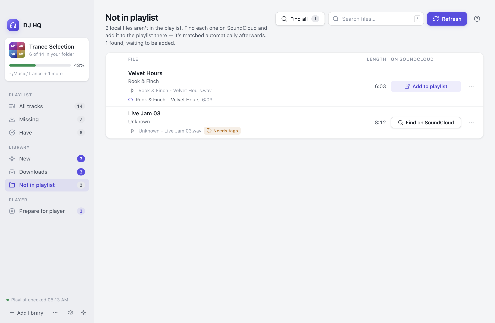

Utwory w twoim folderze, które nie pasują do niczego na playliście. Chodzi
o to, żeby trafiły *na* playlistę, a playlista pozostała jedyną listą, która
zawsze się zgadza.

1. Kliknij **Znajdź wszystkie**, żeby wyszukać na SoundCloud wszystkie pliki
   naraz. Pewne dopasowania są od razu przyjmowane, reszta czeka na twój
   wybór.
2. Dla pozostałych kliknij **Znajdź na SoundCloud**. Wyniki są wypisane
   z długością i stopniem dopasowania; wynik, który już jest na playliście,
   jest oznaczony, a jego wybór łączy plik z tym utworem. Jeśli nic nie pasuje,
   zmień wyszukiwany tekst: krótszy działa lepiej, więc usuń część z remiksem.
3. Wybierz wynik. Wiersz pokazuje teraz znaleziony utwór i przycisk **Dodaj do
   playlisty**, który otwiera go na SoundCloud, żeby można było samodzielnie
   dodać go do playlisty.
4. Przy następnym odświeżeniu plik zostanie automatycznie dopasowany do
   utworu i zniknie z tej listy.

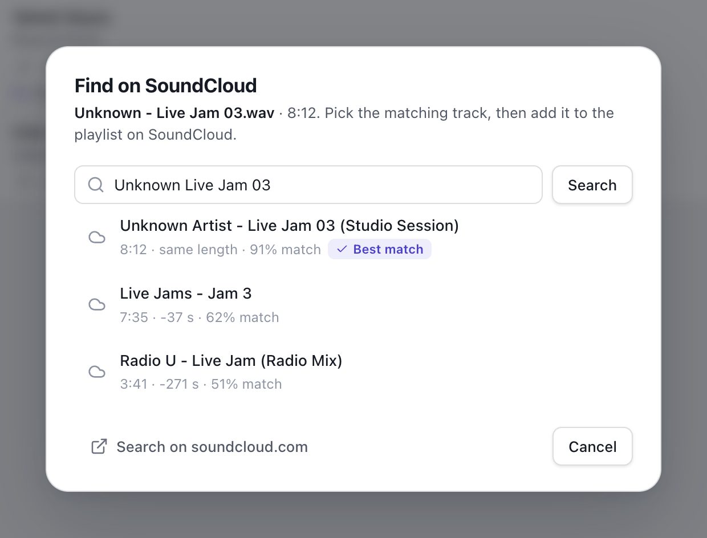

Jeśli wykonawca albo tytuł pliku się nie zgadza (DJ HQ odczytuje je z nazwy
pliku), najpierw kliknij **⋯ → Edytuj wykonawcę / tytuł**; wyszukiwanie i tagi
biorą twoje wartości.

### Przygotuj na odtwarzacz: tagi, konwersja i rekordbox

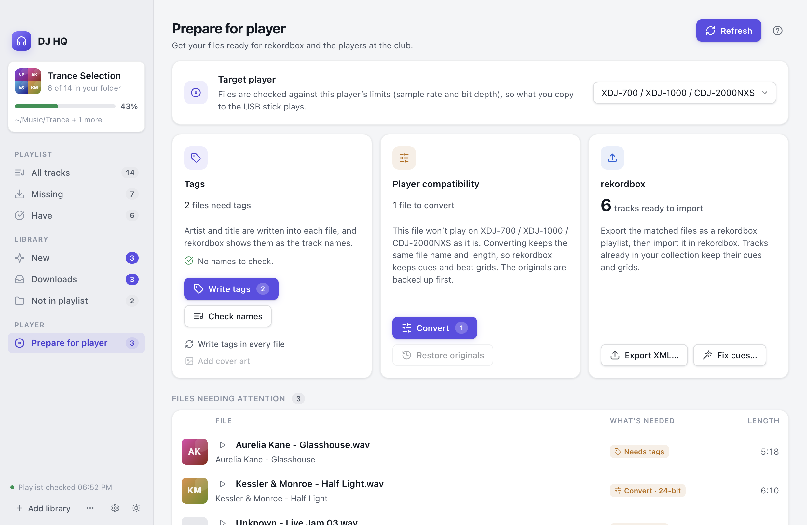

1. **Wybierz swój odtwarzacz** na górze. Wszystko poniżej dostosowuje się do
   tego, co on odtwarza: XDJ-700 i XDJ-1000 przyjmują tylko 16-bitowe pliki WAV
   44,1 albo 48 kHz, a CDJ-2000NXS2, XDJ-XZ i CDJ-3000 odtwarzają też 24 bity,
   96 kHz i FLAC.
2. **Zapisz tagi** zapisuje wykonawcę i tytuł w każdym pliku, w którym ich
   brakuje albo różnią się od nazw pokazywanych przez DJ HQ, tak jak rekordbox
   naprawdę je odczytuje (z plikami WAV jest wybredny). Gatunkiem staje się
   nazwa playlisty. Cała reszta tagów pliku zostaje: tonacja i energia,
   komentarze i okładka. Tonacja jest widoczna obok nazwy pliku i trafia do
   eksportu rekordbox. Plik WAV liczy się jako otagowany dopiero wtedy, gdy
   nazwy są w jego bloku RIFF INFO, który czyta rekordbox; sam tag ID3 nie
   wystarcza.

   Gdy plik ma już tę samą nazwę zapisaną inaczej (wielkie litery,
   interpunkcja), zostaje pisownia z pliku. Gdy ma własnego, innego wykonawcę
   lub tytuł, **Zapisz tagi** najpierw wypisuje te pliki, każdy z tym, co jest
   w pliku, i tym, co zostałoby zapisane, a ty wybierasz **Zapisz nazwy z DJ
   HQ**, **Zostaw nazwy z plików** albo Anuluj. Nazwy wpisane przez ciebie są
   zapisywane dokładnie tak, jak je wpisano, bez pytania. Tak samo nazwa
   zostawiona w oknie **Sprawdź nazwy**, gdy pokazywało ono inną nazwę z pliku.

   Wykonawca i tytuł pochodzą z tytułu na SoundCloud: wykonawca przed
   myślnikiem, tytuł po nim. „Premiere:”, numer katalogowy albo strona winylu
   na początku i „Free DL” w dowolnej pisowni są pomijane, a półpauza liczy się
   jako myślnik. Gdy nazwa wgrywającego (albo pole wykonawcy na SoundCloud)
   stoi po prawej stronie myślnika, obie części są zamieniane. Remiks zachowuje
   oryginalnego wykonawcę; autor remiksu zostaje w tytule. Gdy nic nie
   potwierdza kolejności, utwór dostaje oznaczenie **Sprawdź nazwę**,
   a **Sprawdź nazwy** na karcie Tagi przechodzi przez te nazwy po kolei:
   **Zostaw** (Enter), **Zamień** (S), **Edytuj** (E), pomijanie albo powrót
   strzałkami. Trafia tam też plik, który ma już inną nazwę: okno pokazuje ją
   w wierszu **Teraz w pliku**, a **Weź z pliku** (F) ją przejmuje. Przełącz na
   **Wszystkie nazwy**, żeby przejść przez całą bibliotekę. Twoje wybory są zapamiętywane i mają pierwszeństwo przed tym, co
   odczytuje DJ HQ; **Zapisz tagi** zapisuje je potem w plikach. **⋯ → Zamień
   wykonawcę z tytułem** w wierszu robi to samo dla jednego utworu.
3. **Konwertuj** zamienia pliki, których twój odtwarzacz nie odtworzy, na
   takie, które odtworzy, w tym samym miejscu: ta sama nazwa pliku, ta sama
   długość, więc rekordbox zachowuje twoje punkty hot cue i siatki beatów.
   Oryginały są najpierw zapisywane w kopii zapasowej, a **Przywróć
   oryginały** przywraca je, kiedy chcesz.
4. **Eksportuj XML…** zapisuje playlistę rekordbox ze wszystkimi dopasowanymi
   plikami i pokazuje, jak ją zaimportować. W rekordbox: *Preferences →
   Advanced → Database → rekordbox xml*, raz wskaż ten plik; w drzewie pojawi
   się pozycja *rekordbox xml*, a kliknięcie tam playlisty prawym przyciskiem
   da opcję **Import Playlist**. Utwory, które już są w twojej kolekcji,
   zachowują punkty cue i siatki. Eksportuj ponownie przy każdej zmianie
   playlisty; ścieżka pliku się nie zmienia.

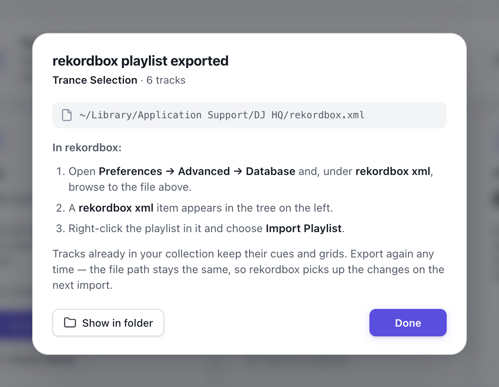

Lista **Pliki wymagające uwagi** poniżej pokazuje dokładnie te pliki, które
wciąż wymagają tagów albo konwersji, zanim będą gotowe do kabiny DJ-a, każdy
z okładką i przyciskiem odtwarzania.

### Wygląd, wyszukiwanie i pasek boczny

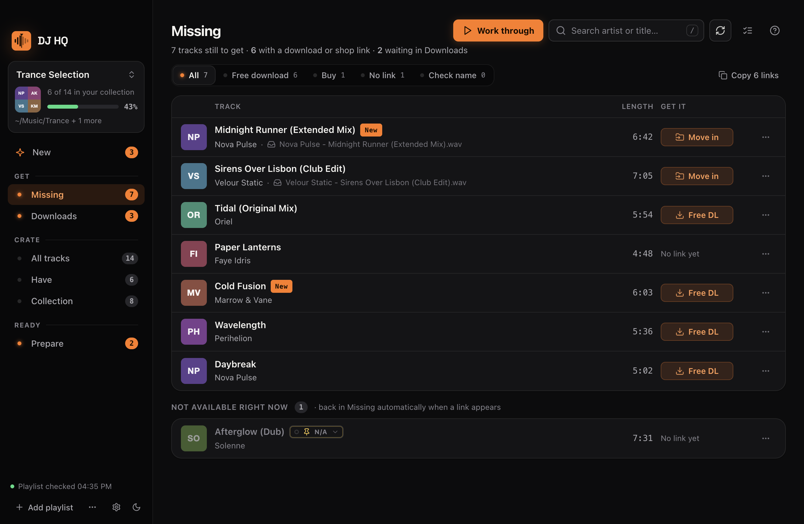

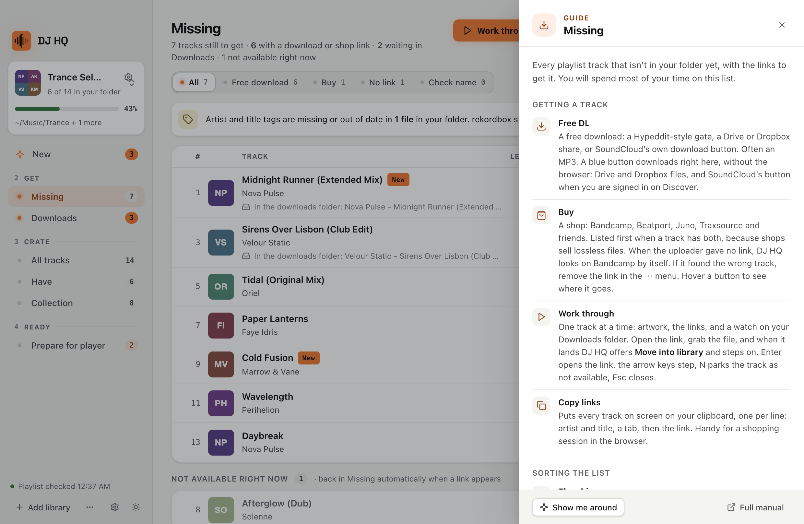

- Przycisk ze słońcem i księżycem na dole paska bocznego przełącza między
  trybem jasnym, ciemnym i „jak w systemie”.
- Pole wyszukiwania filtruje bieżącą listę po wykonawcy, tytule albo nazwie
  pliku. Naciśnij `/`, żeby do niego przejść.
- Przycisk **?** w prawym górnym rogu otwiera Przewodnik po stronie, na której
  jesteś: co znaczy każdy wiersz, oznaczenie, przycisk i filtr oraz co z nimi
  zrobić, dokładniej niż oprowadzanie. To samo daje naciśnięcie `?`.
- Karta biblioteki na górze paska bocznego pokazuje, ile utworów z playlisty
  jest w twoim folderze; liczniki przy każdej liście aktualizują się na bieżąco.
  **Wszystkie utwory** to cała playlista, a **Brakujące** i **Mam** dzielą ją
  na dwie części.
- Przycisk **⋯** na dole paska bocznego otwiera playlistę na SoundCloud,
  ponownie skanuje folder z muzyką, eksportuje plik XML rekordbox, powtarza
  oprowadzanie, sprawdza aktualizacje oraz dodaje i usuwa biblioteki. Zębatka
  obok otwiera Ustawienia.

### Ustawienia

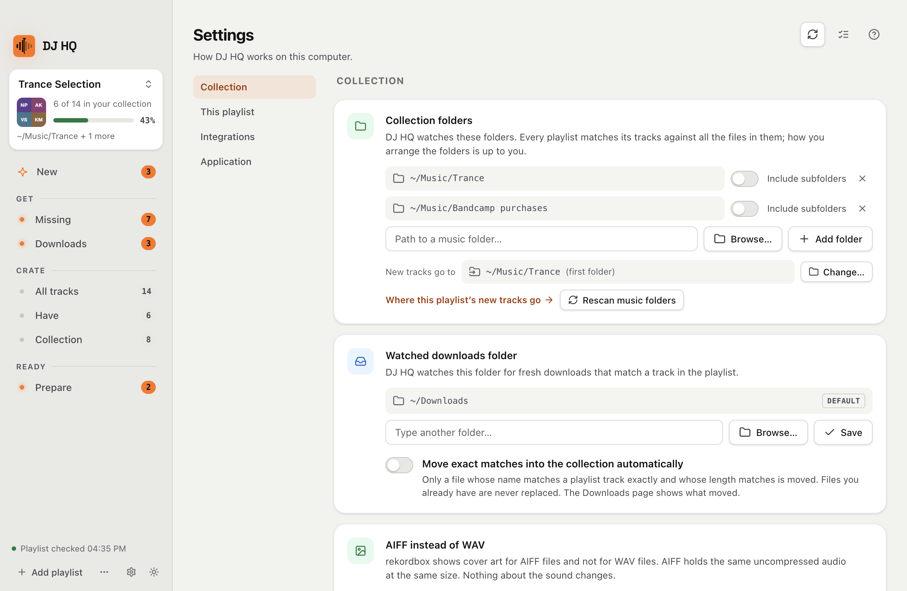

Zębatka na dole paska bocznego. Od góry: biblioteka (jej foldery, playlista,
usuwanie), konto SoundCloud zalogowane na Discover (wylogowanie i przełącznik,
który dodaje do polubień każdy dodany utwór), gdzie otwierają się utwory (Discover albo
przeglądarka), folder Pobrane obserwowany przez DJ HQ i przełącznik
automatycznego przenoszenia dokładnych dopasowań, jak często sprawdzana jest
playlista, wygląd, język,
kopie zapasowe (ile miejsca zajmują oryginały przekonwertowanych plików
i zastąpione pliki MP3, z przyciskiem **Wyczyść**, gdy masz pewność, że nie
będą potrzebne), przenoszenie i kopia konfiguracji (**Eksportuj
konfigurację…** i **Importuj konfigurację…**) oraz aktualizacje.

**Język.** DJ HQ działa po angielsku i po polsku. Przy ustawieniu
**Automatycznie** aplikacja używa języka twojego komputera: po polsku
w polskim systemie, po angielsku w każdym innym. **English** albo **Polski**
ustawia język na stałe. Zmiana działa od razu, bez ponownego uruchamiania,
i obejmuje też Przewodnik, oprowadzanie i okna wyboru plików. Nazwy utworów,
wykonawców i plików oraz komunikaty samego SoundCloud zostają takie, jakie są.

### Więcej niż jeden folder

Biblioteka zaczyna od jednego folderu, ale utwory z playlisty mogą być
rozrzucone po kilku albo posortowane w podfoldery. Oba przypadki działają:

- **Dodaj folder** na karcie biblioteki w Ustawieniach dodaje do biblioteki
  kolejny folder. Pliki w każdym z jej folderów liczą się jako twoje. Pierwszy
  folder pozostaje *główny*: do niego trafiają pobrane pliki. Folder można
  potem usunąć z biblioteki; jego pliki zostają na miejscu.
- **Uwzględnij podfoldery** skanuje też foldery wewnątrz każdego folderu
  biblioteki. Jest wyłączone, dopóki go nie włączysz, więc biblioteka nigdy nie
  bierze więcej, niż chcesz.

Pliki spoza folderu głównego są wypisane z nazwą folderu na początku, na
przykład `Deep/Artist – Title.wav` albo `Vinyl rips/Artist – Title.wav`, żeby
było widać, gdzie leży każdy z nich. Tagi, konwersja, kopie zapasowe
i przywracanie działają na nich jak na każdym innym pliku.

### Więcej niż jedna playlista

Kliknij **+ Dodaj bibliotekę** na pasku bocznym, żeby połączyć inny folder
z inną playlistą, a między bibliotekami przełączaj się, klikając nazwę biblioteki
na górze. Każda biblioteka ma własne dopasowania, zmienione nazwy i oznaczenia nowości.

### Inny komputer albo kopia zapasowa

**Ustawienia → Przenoszenie i kopia konfiguracji → Eksportuj konfigurację…**
zapisuje jeden plik, `DJ HQ config <date>.djhq.json`, ze wszystkim, co DJ HQ
wie o twoich bibliotekach: link SoundCloud i listę utworów każdej biblioteki,
jej dopasowania (ręczne i automatyczne), edytowane nazwy, oznaczenia Mam / Brak
/ niedostępny, nowości i twoje ustawienia (częstotliwość odświeżania,
automatyczne przenoszenie, wygląd, docelowy odtwarzacz). Zapisz go na
pamięci USB albo w folderze w chmurze (tu folder w chmurze to po prostu folder
na dysku) i zaimportuj na drugim komputerze, na komputerze z Windows albo
znowu na tym, jako kopię zapasową.

Czego nie ma w pliku: samej muzyki, oryginałów z kopii zapasowej (więc
*Przywróć oryginały* nie ma czego przywrócić na nowym komputerze), logowania
do SoundCloud, ustawienia języka i ścieżek z tego komputera: folder Pobrane
jest tam wyszukiwany od nowa. Pliki są zapisywane pod nazwą wewnątrz folderu
biblioteki, nigdy pełną ścieżką, więc plik z Maca da się zaimportować na
Windows i na odwrót.

Link udostępniania prywatnej playlisty działa jak hasło. Gdy biblioteka go
używa, eksport o tym mówi i proponuje **Nie zapisuj linków**; biblioteka trafia
wtedy na nowy komputer bez linku, mówi o tym na każdej stronie i nie jest
sprawdzana pod kątem zmian, dopóki nie wkleisz linku ponownie przez **Zmień
link…**. Cała reszta działa na podstawie listy utworów z pliku.

**Importuj konfigurację…** (także na ekranie powitalnym świeżej instalacji)
działa krokami i nic się nie zmienia przed ostatnim:

1. Wybierz plik. DJ HQ go czyta i sprawdza; plik z nowszej wersji DJ HQ, plik
   uszkodzony albo ucięty, a także plik z nazwami plików wskazującymi poza
   folder biblioteki, jest odrzucany.
2. Co jest w środku: dla każdej biblioteki utwory, dopasowania (ręczne
   i znalezione przez DJ HQ), edytowane nazwy i oznaczenia oraz to, co import
   zastąpi na tym komputerze.
3. Foldery z muzyką: dla każdego folderu biblioteki folder na tym komputerze
   (Przeglądaj… albo wpisz ścieżkę). DJ HQ liczy, ile plików biblioteki tam
   znajduje, zanim cokolwiek zmieni. Pliki są znajdowane po nazwie, także gdy
   kopia zmieniła wielkość liter albo sposób zapisu liter z akcentami, oraz po
   nazwie pliku, która występuje w folderze dokładnie raz, gdziekolwiek (wtedy
   włącza się *Uwzględnij podfoldery*). Nazwa, która występuje dwa razy,
   zostaje bez dopasowania, zamiast zgadywania.
4. Potwierdź. Dopasowania, których pliku nie ma w folderze, są usuwane. Gdy
   nie ma tam jeszcze żadnego pliku biblioteki (nowy komputer, muzyka jeszcze
   nieskopiowana), nadal możesz ją zaimportować: biblioteka czeka wtedy na
   swoje pliki, zachowuje wszystkie dopasowania i wskazuje każdy plik, gdy się
   pojawi, dopóki nie klikniesz **Kopiowanie zakończone**. Nic, co wcześniej
   nie było nowe, nie pokaże się jako nowy plik.

Import zastępuje biblioteki na tym komputerze (dodawanie biblioteki obok
istniejących pojawi się później). Zanim cokolwiek zapisze, robi kopię bieżących
danych (`<time>-before-import.djhq.db`) w `backups/` w folderze danych
(zachowywanych jest pięć ostatnich kopii i każda kopia z ostatniego tygodnia).
Żeby wrócić: zamknij DJ HQ, usuń `djhq.db-journal`, jeśli istnieje, i skopiuj
kopię zapasową na miejsce `djhq.db`. Kopia zrobiona przez DJ HQ 1.7 lub
starszy (`…-before-import.state.json`): zamknij DJ HQ, przenieś `djhq.db` poza
folder danych, skopiuj tam kopię zapasową jako `state.json` (a także
`…-before-import.prefs.json` z tego samego czasu, jeśli jest, jako
`prefs.json`, dla ustawień wyglądu) i uruchom DJ HQ; aplikacja przeniesie je do
nowej bazy danych.

## Wskazówki i rozwiązywanie problemów

- **Dopasowanie jest złe.** Kliknij nazwę pliku pod utworem i wybierz
  właściwy plik albo *Bez pliku*. Status pozwala ręcznie ustawić Mam albo
  Brak.
- **Utwór nie ma przycisku Za darmo ani Kup.** Wgrywający nie ustawił linku do
  zakupu i nie podał go w opisie. Menu **⋯** nadal otwiera utwór na
  SoundCloud.
- **Znajdź na SoundCloud nic nie znajduje.** Spróbuj krótszego tekstu i usuń
  część z remiksem. Niektórych wersji po prostu nie ma na SoundCloud; **⋯ →
  Szukaj na soundcloud.com** otwiera wyszukiwarkę samej strony.
- **Kliknięcie okładki otwiera Discover, ale nic nie gra.** SoundCloud wymaga
  zalogowania, zanim cokolwiek odtworzy. Zaloguj się raz na stronie Discover;
  sesja zostaje zapamiętana.
- **„SoundCloud chce sprawdzić, czy jesteś człowiekiem”.** Ochrona SoundCloud
  przed botami pokazała weryfikację (captcha) na stronie Discover. Otwórz
  Discover, rozwiąż ją, a odtwarzanie, Dodaj i serce znowu zadziałają.
- **Pobrany plik się nie pojawia.** Archiwa zip i niedokończone pobieranie są
  pomijane: rozpakuj, poczekaj, aż pobieranie się skończy, i kliknij
  **Przeskanuj ponownie**. Plik, którego nazwa już istnieje w twoim folderze,
  liczy się jako „już w bibliotece”.
- **rekordbox po konwersji wciąż pokazuje starą głębię bitową.** Ta kolumna
  jest zapamiętana. Kliknij utwór prawym przyciskiem → *Analyze Track* (punkty
  hot cue przetrwają) albo po prostu to zignoruj; odtwarzanie używa
  prawdziwego pliku.
- **Tagi nie są widoczne przy utworach, które już są w rekordbox.** Zaznacz
  je → prawy przycisk → *Reload Tag*.
- **Playlista XML się zaimportowała, ale utwory wyglądają tak samo.** To
  kaprys rekordbox: import playlisty nie aktualizuje utworów, które już są
  w kolekcji. Kliknij prawym przyciskiem utwory w gałęzi *rekordbox xml*
  i zaimportuj także je.
- **„Nie udało się wczytać biblioteki: operation not permitted” (macOS).** Daj
  aplikacji dostęp do folderu z muzyką w Ustawienia systemowe → Prywatność
  i ochrona → Pliki i foldery.
- **macOS mówi, że aplikacja jest „uszkodzona” i należy ją przenieść do
  Kosza.** Dzieje się tak, gdy narzędzie do pobierania usunie podpis aplikacji.
  Pobierz plik DMG ponownie przez Safari albo Chrome. Jeśli nadal widać
  komunikat o uszkodzeniu, jednorazowa poprawka w Terminalu to
  `xattr -cr "/Applications/DJ HQ.app"`.

## Twoje pliki i twoje dane

**DJ HQ ostrożnie obchodzi się z twoimi plikami.** Zapis tagów kopiuje dźwięk
bit w bit i sprawdza go przed zastąpieniem pliku; przy jakiejkolwiek
wątpliwości oryginał zostaje nietknięty. Konwersja najpierw zapisuje oryginał
w kopii zapasowej, a potem sprawdza długość, i kopie zapasowe nigdy nie są
usuwane. Przeniesienie pobranego pliku to prawdziwe przeniesienie, a nie
skopiowanie i zapomnienie. Mimo to rób własne kopie zapasowe: to twoja
biblioteka.

**Gdzie co jest.** Aplikacja trzyma dane w systemowym folderze danych
użytkownika: `~/Library/Application Support/DJ HQ` na macOS
i `%APPDATA%\DJ HQ` w Windows. Uruchomiona ze źródeł używa zamiast tego
folderu projektu. W środku:

| | |
| --- | --- |
| `djhq.db` | baza danych: biblioteki, kopie playlist, ręczne dopasowania, zmienione nazwy, oznaczenia nowości, ustawienia i wygląd (`djhq.db-journal` leży obok, gdy DJ HQ działa) |
| `originals/<library>/` | oryginały zapisane przed konwersją |
| `originals/<library>/replaced/` | pliki MP3 zastąpione przez pobrane pliki bezstratne |
| `rekordbox.xml` | ostatni eksport rekordbox |
| `backups/` | kopie `djhq.db` sprzed każdego importu konfiguracji (ostatnie pięć i wszystkie z ostatniego tygodnia) |
| `state.json.imported-<time>` | `state.json` z DJ HQ 1.7 lub starszego, taki, jaki był w chwili przeniesienia do `djhq.db` (zachowany, nigdy więcej nie czytany; tak samo `prefs.json`) |
| `Partitions/` | sesja logowania do SoundCloud dla Discover (Ustawienia → Wyloguj się ją usuwa) |

Każdy zapis to jedna transakcja SQLite, która zapisuje tylko to, co się
zmieniło, i trafia na dysk, zanim DJ HQ pójdzie dalej, więc awaria albo zanik
zasilania zostawia dane z ostatniego zakończonego zapisu. Jeśli bazy danych
nie da się odczytać przy starcie, DJ HQ odkłada ją na bok jako
`djhq.db.unreadable-<time>`, zaczyna od nowa i o tym mówi, zamiast ją
nadpisać. Dane zapisane przez nowszą wersję DJ HQ są pokazywane, ale starsza
wersja nigdy ich nie zapisuje. Z jednego folderu danych może naraz korzystać
tylko jedna kopia DJ HQ (okno albo serwer headless); druga o tym mówi i się
zamyka.

Trzymaj folder danych na lokalnym dysku, nie w iCloud Drive, Dropboksie,
OneDrive ani na Dysku Google: klient synchronizacji, który kopiuje bazę danych
i jej dziennik w różnych chwilach, może ją uszkodzić. Żeby przenieść dane,
użyj **Eksportuj konfigurację** (zobacz wyżej).

**Powrót do starszej wersji.** DJ HQ 2.0 i nowsze trzymają dane w `djhq.db`;
pierwsze uruchomienie przenosi do niej `state.json` i `prefs.json` i zachowuje
te pliki jako `state.json.imported-<time>` (obok leży `state.json.README.txt`,
który mówi to samo). DJ HQ 1.7 i starsze nie czytają `djhq.db` i startują
puste. Żeby zabrać do takiej wersji bieżące dane: gdy DJ HQ jeszcze działa,
zapisz je przez **Ustawienia → Eksportuj surowe dane (JSON)** (albo
`GET /api/state/raw` w trybie headless); zamknij DJ HQ; umieść ten plik
w folderze danych jako `state.json`. Zmiana nazwy
`state.json.imported-<time>` z powrotem na `state.json` też działa, ale to są
dane sprzed aktualizacji. Surowy eksport pomija ustawienia wyglądu (motyw,
obejrzane oprowadzanie): żeby je zachować, zmień nazwę
`prefs.json.imported-<time>` z powrotem na `prefs.json`.

**Ponowne przejście na nowszą wersję.** Dopóki `djhq.db` zawiera dane,
DJ HQ 2.0 i nowsze dalej jej używają i nigdy więcej nie czytają `state.json`:
plik zapisany po przeniesieniu (przez starszą wersję DJ HQ albo przywrócony
surowy eksport) zostaje bez zmian, a informacja mówi, że nie jest używany.
Żeby zamiast tego pracować dalej na tym pliku: zamknij DJ HQ, przenieś
`djhq.db` poza folder danych i uruchom DJ HQ; aplikacja przeniesie `state.json` do
nowej bazy danych. Żeby zachować bazę danych, przenieś `state.json` poza folder
danych.

Gdy folderu biblioteki nie ma (odłączony dysk, folder w chmurze, który się
jeszcze nie zsynchronizował, folder o zmienionej nazwie), aplikacja o tym mówi
i niczego nie zapomina: ręczne dopasowania i oznaczenia nowości wracają razem
z folderem.

**O SoundCloud.** Nie ma klucza API: aplikacja czyta te same publiczne
adresy, których używa odtwarzacz SoundCloud w przeglądarce. Dziś to działa,
ale może przestać, gdy tylko SoundCloud zmieni swoją stronę. Działają
publiczne playlisty, a prywatne przez link udostępniania, który DJ HQ trzyma
w `djhq.db`. Aplikacja zapisuje coś na SoundCloud tylko z Discover, gdzie
logujesz się na własne konto, i tylko wtedy, gdy dodajesz albo usuwasz utwór lub
klikasz serce (nie zmieni playlisty, której nie widzi w całości, bo zapis usunąłby
utwory, których nie widzi); DJ HQ nigdy nie widzi twojego hasła, bo logowanie
odbywa się na soundcloud.com w aplikacji. Playlista jest wczytywana przy
starcie, co 15 minut, gdy okno jest otwarte, i gdy klikniesz Odśwież;
wyszukiwanie utworów działa tylko wtedy, gdy używasz Znajdź na SoundCloud albo
Znajdź wszystkie.

## Szczegóły techniczne

Uruchamianie ze źródeł, tryb headless, budowa projektu, tłumaczenia (jak dodać
kolejny język), HTTP API i wydania są opisane po angielsku w
[README.md → Technical details](README.md#technical-details); o językach
w [README.md → Languages](README.md#languages).

## Licencja

MIT – zobacz [LICENSE](LICENSE).
